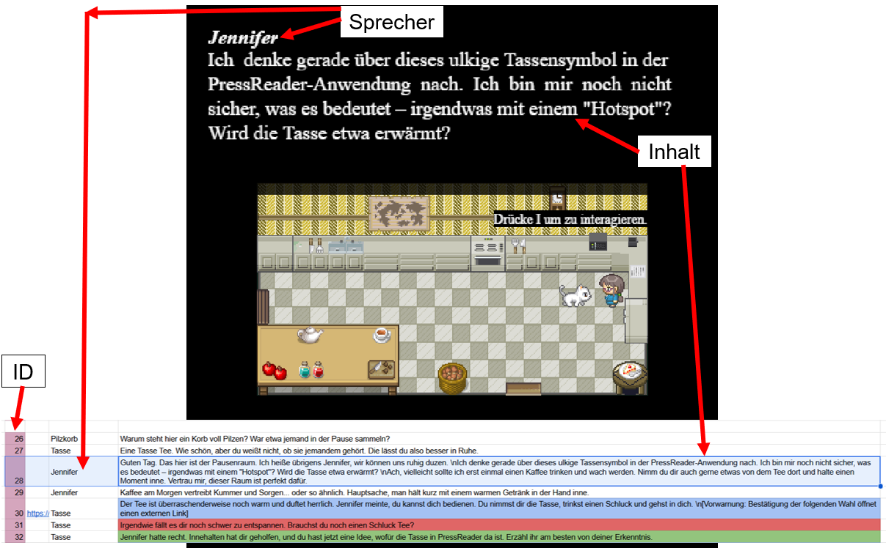

# Projekt "Lernkurs für das Lernen über das Onlineangebot PressReader für die Leipziger Bibliotheken"

### Informationen über das Projekt

Bei diesem Projekt wurde ein Lernspiel zu der Anwendung PressReader für die Mitarbeiter der Leipziger Stätischen Bibliotheken erstellt. Dabei sind fast alle Texte über eine Google Sheet Datei und ohne das Anfassen vom Code veränderbar (auch die Dialog-Logik) und die Lerninhalte wurden mit extra Werkzeugen erstellt und liegen außerhalb des Spieles, wo der Spieler zu diesen im Spielverlauf weitergeleitet wird. Dieses hybride System aus programmierter Spielwelt und externen Lerninhalten war eine zuvor mit dem Kunden vereinbarte Pflichtbedingung, da das Spiel auch leicht für nicht-Informatiker veränderbar sein sollte.

Für weitere Informationen zum Projekt und dessen Entwicklung sehen Sie sich das Game-Design-Document (GDD) im gleich benannten Ordner an.

### Erste Schritte um das Projekt zu starten

Um das Projekt zu spielen benötigt man lediglich den Link: 
[https://lsblernkurs.github.io/Website-fuer-Lernkurs-fuer-Onlinangebot-der-Leipziger-Bibliotheken/](https://lsblernkurs.github.io/Website-fuer-Lernkurs-fuer-Onlinangebot-der-Leipziger-Bibliotheken/) 

Texte, Dialog-Logik und Verlinkungen können im Spiel über die folgende Google Sheet Datei verändert werden: 
[https://docs.google.com/spreadsheets/d/1GhV-vsDTEcP0YhTAAtd7-4u_QGMf1JG_dUQR1n9ROY8/edit?usp=drivesdk](https://docs.google.com/spreadsheets/d/1GhV-vsDTEcP0YhTAAtd7-4u_QGMf1JG_dUQR1n9ROY8/edit?usp=drivesdk) 

Für alles weitere muss man an den Code: Google Sheet Datei austauschen, Spielerfigur austauschen, einen Raum bearbeiten/hinzufügen, ein Objekt/eine Person bearbeiten/hinzufügen, etc.

Zur Bearbeitung empfehle ich Visual Studio Code sowie eine Git Clone Verbindung zu diesem Repository mithifle von Git Bash. Wenn beides heruntergeladen wurde, auf der GitHub-Seite unter dem grünen Code-Knopf den HTTPS Link kopieren und im Terminal in Visual Studio Code "git clone die-link-adresse" eintippen. Für die weitere mögliche Nutzung von Git empfehle ich ein Tutorial anzuschauen (z.B.: [https://youtu.be/a0_AcknhqDY?si=BxkdA-iQIEcqZNoL](https://youtu.be/a0_AcknhqDY?si=BxkdA-iQIEcqZNoL) auf YouTube oder [https://www.w3schools.com/git/](https://www.w3schools.com/git/) das interaktive Tutorial von W3School).

### Regeln im Google Sheet

#### Aufbau

Es gibt zwei Tabs/Seiten: Zum einen die "Texte" und zum anderen die "Regeln"-Seite.

In der "Texte"-Seite stehen die Namen der Räume, die (ungefähre) Dauer um den Raum jeweils durchzuarbeiten, der Titel-Text ganz am Anfang und der Text am Ende, sowie alles an Dialog. Mit Dialog ist in diesem Fall alle Stellen gemeint, wo man mit einer Person oder einem Objekt interagieren kann. Diesen Text im Textfeld kann man anpassen.

Dabei braucht es immer eine Id, einen Sprecher (das ist der Text, welcher oben links im Textfeld steht), sowie den eigentlichen Inhalt für das Textfeld. Außerdem lässt sich ein Link für den externen Lerninhalt angeben.

Immer, wenn man einen Link angibt bedeutet das im Spiel, dass es eine Abfrage für den Spieler gibt und der Link nur geöffnet wird, wenn der Spieler "Ja" auswählt. Darum benötigt man zwei Antworten direkt unter dem Text mit dem Link: Wenn man "Nein" auswählt, dann kommt automatisch der nächste Text gleich darunter (Id +1) und bei "Ja" kommt der übernächste Text (Id +2)

#### Dialog-Logik

Abfragen: 
Zu einer Abfrage kommt es nur, wenn bei einer Id ein Link hinterlegt ist. 
Bei Antwort "Nein" kommt automatisch der nächste Text gleich darunter (Id +1) 
Und bei Antwort "Ja" der übernächste Text (Id +2) 
=> Darum habe ich Inhalte mit einer Abfrage blau, die "Nein"-Antwort rot und die "Ja"-Antwort grün markiert.

Die Bedingungen: 
**Pro Objekt werden die Zeilen von oben nach unten geprüft. Die erste Zeile, deren Bedingung stimmt, gewinnt.** 
Hier ist mit "objekt" NICHT der gesetzte "sprecher"-Text in der "Texte"-Seite gemeint, sondern die Bezeichnung dieser Figur bzw. dieses Objektes im Spielcode.

Schreibweise Bedeutung 
"immer" oder leer trifft immer zu 
"ja(X)" / "nein(X)" letzte Antwort bei X war Ja / Nein 
"offen(X)" bei X wurde noch nicht geantwortet 
"fertig(X)" X wurde schon einmal mit Ja abgeschlossen (bleibt gemerkt) 
"gesprochen(X)" mit X wurde schon ein Dialog geöffnet 
"meinFlag" ein eigenes Flag, das über die Spalten "setzt…" gesetzt wurde 
"UND", "ODER", "NICHT", "( )" verknüpfen (auch "&", "\|", "!")

Hinweis: Zeilen, die mit "#" beginnen, werden ignoriert (z.B. für Überschriften nutzen).

Flags setzen: 
"setzt": wird ausgeführt, sobald dieser Text geöffnet wird 
"setzt_nach_ja" / "setzt_nach_nein": wird ausgeführt, wenn der Dialog mit Ja bzw. Nein endet 
Mehrere Flags mit Komma trennen 
"!name" löscht ein Flag 
Flags mit Präfix "raum4_" werden beim Betreten von Raum 4 zurückgesetzt (gleiches für "raum1_" bis "raum3_") 
Flags ohne Präfix bleiben dauerhaft erhalten und sind damit raumübergreifend nutzbar

Zähler: 
Schlüssel werden in einem Zähler gemerkt, wo man mit "schluessel+1" (oder einer anderen Zahl) die Anzahl erhöhen kann. Ein Schlüssel wird immer dann verbraucht, wenn eine Tür im Spiel geöffnet wird, wodurch der Zähler intern um eins verringert wird.

Beispiel: 
objekt bedingung text_id setzt setzt_nach_ja setzt_nach_nein 
??? fertig(???) 56 
??? offen(???) 50 schluessel+1, raum3_schluesselBekommen 
??? nein(???) schluessel+1, raum3_schluesselBekommen 

Was hier passiert:
Wenn der Spieler mit dem Npc (also der Person im Spiel) interagiert, dann wird zuerst überprüft, ob der Spieler bereits einmal eine Abfrage von diesem Npc mit "Ja" beantwortet hat. Wenn dies der Fall ist, dann wird der Text mit der Id 56 angezeigt. Wenn dies jedoch nicht der Fall ist, dann wird auf die nächste Zeile geschaut. Hier ist die Frage, ob der Spieler überhaupt schon mal eine Abfrage von dieser Figur beantwortet hat. Wenn der Spieler noch nichts beantwortet hat, dann würde diese Zeile als richtig gelten und daher ausgeführt werden, indem der Dialog mit der Id 50 gezeigt wird und der Spieler bekommt hier eine Abfrage. Das bedeutet auch, dass bei Id 50 ein Link hinterlegt sein muss. Wenn der Spieler bei dieser Abfrage "Ja" ausgewählt hat, dann soll er einen Schlüssel für diesen Raum bekommen (mit einer extra Flag zum merken, dass der Spieler einen Schlüssel erhalten hat). Wenn er jedoch "Nein" ausgewählt hat, erhält der Spieler nichts und das Spiel merkt sich, dass "???" nun nicht mehr offen ist, sondern mit "Nein" beantwortet wurde. Wenn der Spieler nun erneut mit "???" spricht, würde die Zeile drei ausgeführt werden, da "???" gerade weder offen noch fertig ist. Es wird der Text von Id 53 gezeigt und der Spieler soll auch hier den Schlüssel (und die Flag) erhalten, wenn er mit "Ja" antwortet. Wenn er erneut "Nein" auswählen würde, dann würde "???" nein bleiben und beim darauffolgenden Ansprechen bleibt es bei der Ausführung von Zeile drei. 

Bei diesen Beispiel kann es zu einem folgenden Spielverlauf kommen: 
Spieler spricht zum ersten mal mit "???" -> Zeile zwei wird ausgelöst -> Spieler wählt "Nein" aus 
Darauf spricht Spieler erneut "???" an -> Zeile drei wird ausgelöst -> Spieler wählt erneut "Nein" 
"Nein"-Auswahl wird gemerkt, erneutes Ansprechen -> Zeile drei wird ausgelöst -> Spieler wählt nun "Ja" und erhält den Schlüssel 
"???" ist nun fertig, wieder Ansprechen -> Zeile eins wird ausgelöst -> es bleibt immer bei Zeile eins nun, da "???" fertig 

### Externe Lerninhalte

Fast alle externen Lerninhalte sind mithilfe von Genially (in der kostenlosen Version) erstellt worden. Nur ein zusätzlicher Fragensatz wurde in Blooket erstellt (jedoch wird hierfür ein Blooket Account zum Spielen des Fragensatzes benötigt).

Genially Anmeldung in PressReader: [https://view.genially.com/6aa23b52ad6458ad4a402cde](https://view.genially.com/6aa23b52ad6458ad4a402cde)  
Genially Test zur Anmeldung: [https://view.genially.com/6aa2827d32c64b7a0069b0f9](https://view.genially.com/6aa2827d32c64b7a0069b0f9)  
Genially HotSpot in PressReader: [https://view.genially.com/6aacce5a41bac51a6ad69e74](https://view.genially.com/6aacce5a41bac51a6ad69e74)  
Genially Test zu HotSpot: [https://view.genially.com/6ab0c499e9d29ed143399a74](https://view.genially.com/6ab0c499e9d29ed143399a74)  
Genially Suchen von Zeitungen/Zeitschriften: [https://view.genially.com/6ad08dddf6842d1535a87fa1](https://view.genially.com/6ad08dddf6842d1535a87fa1)  
Genially Kopieren in der App: [https://view.genially.com/6ab393125ae77015b514d2fc](https://view.genially.com/6ab393125ae77015b514d2fc)  
Genially Kopieren im Browser: [https://view.genially.com/6ab393b43c2f07e3a0811548](https://view.genially.com/6ab393b43c2f07e3a0811548)  
Genially Drucken: [https://view.genially.com/6ab3921a5ae77015b51423ee](https://view.genially.com/6ab3921a5ae77015b51423ee)  
Genially Drucken ohne Wasserzeichen: [https://view.genially.com/6ab390215c8cbd7289abb0c5](https://view.genially.com/6ab390215c8cbd7289abb0c5)  
Genially Test zum Kopieren und Drucken: [https://view.genially.com/6ab38e997acacbd9e2df5d03](https://view.genially.com/6ab38e997acacbd9e2df5d03)  
Blooket Fragensatz: [https://dashboard.blooket.com/set/6aa744ea94771cf9e023f0ab](https://dashboard.blooket.com/set/6aa744ea94771cf9e023f0ab)  

### Code-Praktiken (Skripte)

Um das Skript für ESLint auszuführen, muss folgendes ins Terminal eintippt und ausgeführt werden: 
`npm run lint` 

Dadurch wird der gesamte Code auf Fehler und unsaubere Logik getestet. Auch wird auf saubere Kommentierung des Codes geschaut.

Um das Skript für Prettier auszuführen, muss folgendes ins Terminal eintippt und ausgeführt werden: 
`npm run prettier` 

Dadurch wird der gesamte Code auf eine einheitliche Formatierung gebracht, wodurch dieser besser lesbar wird.

### Grobe Abläufe um etwas im Code zu verändern

#### Google Sheet Datei wechseln

Alles, was mit der Sheet-Adresse zu tun hat, steht in sheet-config.js. Nur dort muss man etwas ändern:

Im neuen Google Sheet: Datei -> Freigeben -> Im Web veröffentlichen (jeden Tab einzeln, Format TSV bzw. “Tabulatorgetrennte Werte”). 
Die veröffentlichte Adresse (alles bis einschließlich `/pub`) in `BASIS_URL` eintragen. 
REGELN_GID anpassen: Das ist die Zahl hinter gid= in der Adresszeile des Regeln-Tabs. 
Der Text-Tab wird über `tsvUrl(0)` geladen, also muss er der erste Tab (gid 0) sein. Hat er eine andere gid, ersetze die 0.

Wichtig: Das neue Sheet muss denselben Aufbau haben, sonst funktioniert nichts mehr (preload-scene.js liest die Spalten nach Position):

Text-Tab, Spalten (0 = erste): Raumnamen | Raumdauer | Anfang-und-Ende-Text (Eintrag 1 = Anfang, Eintrag 2 = Ende) | ID | Link | Sprecher | Inhalt. Zeile 1 ist die Überschrift. Ändert sich die Reihenfolge, muss man das Objekt `SPALTE` oben in preload-scene.js anpassen. 
Regeln-Tab, Spalten: objekt | bedingung | text_id | setzt | nach_ja | nach_nein (siehe parseRegelnTsv in dialog-system.js). 
Text-IDs müssen Zahlen sein. Bei Texten mit Link folgen “Nein” = ID + 1 und “Ja” = ID + 2.

Beim Start schreibt der Code Warnungen in die Browser-Konsole (z.B. fehlende Text-IDs, Konsole mit Taste "F12" öffnen). Dort sieht man sofort, ob das neue Sheet passt.

#### Spielerfigur Aussehen ändern

Die Figur wird in zwei Dateien festgelegt:

1. preload-scene.js: Dort wird das Spritesheet geladen: `this.load.spritesheet("cat", "assets/charaktere/Cat 01-1.png", { frameWidth: 32, frameHeight: 32 });` <- Den Dateipfad durch das neue Bild ersetzen.

2. spieler.js: Hier hängt alles am Aufbau des Spritesheets. Das neue Bild muss 4 Zeilen mit je 3 Frames à 32x32 px haben, in der Reihenfolge runter, links, rechts, hoch. Hat es einen anderen Aufbau, müssen die Frame-Nummern in `anims` angepasst werden (`laufe_runter: [0, 1, 2]` usw.).

Außerdem zu beachten: 

- Spawn-Frames: Jede Raum-Scene setzt `this.spawnFrame` (1 = runter, 4 = links, 7 = rechts, 10 = hoch). Ändert sich die Frame-Anordnung, müssen diese Werte in den vier Räumen mit angepasst werden.
- Wenn man den Namen `"cat"` ändern will, musst dieser an allen drei Stellen ersetzt werden: preload-scene.js, `super(scene, x, y, "cat", ...)` und `generateFrameNumbers("cat", ...)` in spieler.js.

#### Eine neue interaktive Stelle (Figur/Objekt) erstellen

In Tiled: 

1. Im Raum den Objekt-Layer `InteraktionsLayer` öffnen und ein Rechteck dort platzieren, wo die Figur/der Gegenstand stehen soll.
2. Dem Objekt einen eindeutigen Namen geben (z.B. npcGaertner oder statue). Bei Gegenständen bestimmt die Rechteckgröße direkt die Interaktionszone.
3. Bei einer Figur: Das Bild wird nicht in Tiled gezeichnet, sondern per Code als Sprite eingefügt. Das Rechteck markiert nur die Position und die 32x32-Größe.
4. Soll der Spieler nicht hindurchlaufen können, ergänzt man bei Gegenständen im `CollisionLayer` ein Rechteck (bei NPCs macht der Code das automatisch).

Im Code (Datei des jeweiligen Raums, in `create()`):

Gegenstand: den Tiled-Namen in die Liste von `erstelleGegenstaende` aufnehmen: `this.erstelleGegenstaende(map, ["buchregal", "statue"]);` 
Der Name im Regeln-Tab kann abweichen (z.B. tiled: "schluessel", objekt: "pilzkorb").

Figur: In `#loadSpriteSheets()` das Spritesheet laden (32x32 pro Bild, Ausnahme z.B. der Dämon mit 96x96). 
In `erstelleNpcs` einen Eintrag hinzufügen: 
`{` 
`tiled: "npcGaertner",        //Name in Tiled` 
`objekt: "gaertnerRaum1",     //Name im Regeln-Tab` 
`textur: "gaertnerRaum1",     //Key aus dem Spritesheet` 
`frame: 1,                    //Blickrichtung: 1 = unten, 4 = links, 7 = rechts, 10 = oben` 
`interaktionsraum: { dx: 0, dy: 32, breite: 32, hoehe: 16 },` 
`}` 
Da die Figur den Spieler blockiert, muss der `interaktionsraum` neben oder ein Stück über die Figur hinaus liegen (z.B. dy: 32 = direkt darunter). `automatisch: true` startet den Dialog schon beim Betreten der Zone und nicht erst beim Drücken von der "I"-Taste.

Im Google Sheet: Im Text-Tab die Texte mit neuen, fortlaufenden IDs anlegen (Sprecher + Inhalt; Link nur, wenn eine Ja/Nein-Frage folgen soll). Im Regeln-Tab mindestens eine Zeile für das Objekt anlegen: Objektname | Bedingung | text_id. Die erste zutreffende Regel von oben gewinnt, also spezielle Bedingungen zuerst, "immer" zuletzt. 
Namenskonvention beachten: Flags mit Präfix raumN_ (z.B. raum1_...) werden beim Betreten von Raum N automatisch zurückgesetzt.

#### einen neuen Raum bauen

1. Raum in Tiled erstellen (Kachelgröße 32x32). Erwartete Layer (Namen exakt so):

- Kachel-Layer: BodenLayer, WaendeLayer, MoebelLayer, TuerLayer, KleinkramLayer, optional ueberSpielerLayer (wird über dem Spieler gezeichnet)
- Objekt-Layer: CollisionLayer, InteraktionsLayer, SpawnLayer (Objekt Spawn), WeiterLayer (Objekt weiter), TuerBarriereLayer (Objekt TuerBarriere, nur bei Räumen mit Tür)
- Als ".tmj" exportieren und zu einer ".JSON" Datei umbenennen. Achtung: Tileset-Bilder müssen eingebettet sein (beim Erstellen in Tiled auf das Symbol mit dem Blatt Papier und einem herauskommenden Pfeil klicken) und der Tileset-Name in Tiled muss mit dem Namen in `addTilesetImage` übereinstimmen.

2. Dateien im Projekt ablegen, z.B. in assets/fuenfter-raum/ (Tilemap-JSON + Tileset/Asset-PNGs).

3. Neue Scene-Datei fuenfter-raum-scene.js anlegen. Am einfachsten kopiert man zweiter-raum-scene.js (Raum mit Tür) oder vierter-raum-scene.js (ohne Tür) und passt an:

- Klassenname und Key (`SCENE_KEYS.FUENFTER_SCENE`)
- `init(): this.raumNummer = 5` und `this.spawnFrame (Blickrichtung beim Start)`
- `#loadImages()`: Keys und Pfade der Tilesets und der Tilemap (die Keys müssen eindeutig sein, z.B. `fuenfter_asset1`, `JSONfuenfterRaum`)
- `create()`: Tilemap-Key, `addTilesetImage`-Namen, alle Layer in der gewünschten Reihenfolge, NPCs, Gegenstände, Tür (falls vorhanden)
- `#loadSpriteSheets()`: die Spritesheets (also die Asset-PNGs) der Figuren
- Kommentar am Dateianfang mit den Inhalten des Raums (hilft für einen besseren Überblick im Code)

4. Registrieren (drei Stellen):

- `scene-keys.js`: `FUENFTER_SCENE: "FUENFTER_SCENE"` hinzufügen.
- main.js: Import ergänzen und `game.scene.add(SCENE_KEYS.FUENFTER_SCENE, FuenfterRaumScene);`
- raum-wechsel.js: In das Array `RAUM_SCENES` an der richtigen Stelle eintragen (die Reihenfolge bestimmt die Raumnummer und den Nachfolger). `ANZAHL_RAEUME` passt sich automatisch an, ebenso die Karte im Menü.

5. Folgen für die bestehenden Teile prüfen:

- Letzter Raum: Der bisherige letzte Raum (Raum 4) führt jetzt automatisch zu Raum 5 statt zum Ende, das übernimmt `holeNaechsteSceneKey`.
- Zahlentasten: anfang-scene.js und menu-scene.js haben Tasten nur für 1 bis 4 hart verdrahtet (`eins` bis `vier`, `#zahlenTasten`, `raumTasten`). Für Raum 5 muss man dort jeweils `FIVE` und `NUMPAD_FIVE` und den Eintrag in den Tastenlisten ergänzen. Auch in `update()` von AnfangScene (Rückfrage: `tasten[2]`, `tasten[3]` werden verworfen) sollte `tasten[4]` mit verworfen werden.
- Sheet (Text-Tab): In der Spalte "Raumnamen" und "Raumdauer" einen fünften Eintrag ergänzen, sonst erscheint der Platzhalter “Raum 5”.
- Sheet (Regeln/Texte): Die Dialogregeln und Texte für die neuen Figuren/Gegenstände anlegen (siehe Punkt 3).
- Tür oder Barriere: Bei Raum mit Schlüsseltür `richteTuerEin(...)` im Stil von Raum 2 verwenden. Der Schlüssel muss im Raum selbst (über das Sheet: "schluessel+1") erhältlich sein, da der Zähler bei jedem Raumbetreten auf 0 zurückgesetzt wird. Bei einem Raum mit Boss-Barriere an Raum 4 orientieren (`weiterBarriereLayer`, `istFertig(...)` in `update()`).
- `weiter`-Zone im letzten Raum: Diese führt dann zur EndeScene.

Tipp zum Testen: In main.js kann man `debug: true` setzen, dann sieht man Hitboxen und Interaktionszonen. Fehlende Layer oder Objekte meldet der Code als Warnung in der Konsole (`[Raum] Objekt "..." fehlt ...`).
