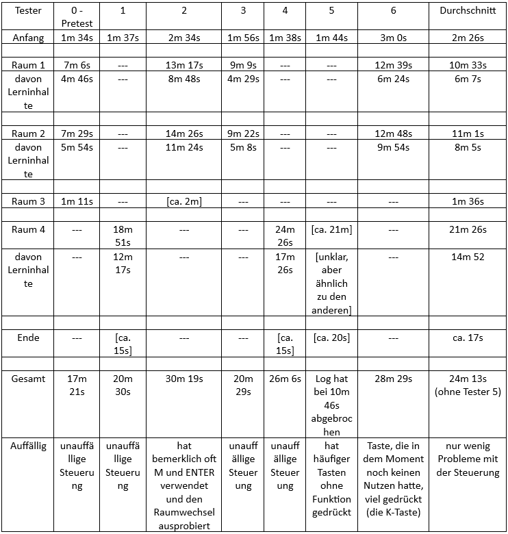

# 1. Projektübersicht & Mission Statement

Dieses Projekt dient der Entwicklung eines Spiels, welches von Mitarbeitern der Leipziger Bibliotheken gespielt werden kann, um über das Onlineangebot PressReader und dessen Nutzung zu lernen. Dabei wird eine Art hybrides System gebaut, wo auf der einen Seite die kodierte Spielwelt liegt, in der man sich als Spieler bewegen und Dinge entdecken kann. Auf der anderen Seite stehen die Lerninhalte, die über Lernspiele und anderer Methoden auf extra Seiten erlernt werden. Die Idee ist, dass man die Lerninhalte ganz leicht über ein Google Sheet austauschen kann und somit ohne jegliche Programmierungskenntnisse der Lernkurs verändert werden kann. Somit kann man einfach ein neues Lernspiel, z.B. ein Quiz, erstellen, den Link mit einem anderen Link im Sheet austauschen und vom Spiel aus käme man nun zu diesem neuen Lerninhalt. Dadurch kann die Spielwelt wiederverwendet und angepasst werden. Dies gilt auch für fast alle anderen Texte im Spiel.

Die Anwendung ist für Mitarbeiter der Leipziger Bibliotheken gedacht. Die Motivation ist, dass PressReader, ein Onlineangebot der Leipziger Bibliotheken, über das man aktuelle Zeitungen und Zeitschriften lesen kann, nicht immer leicht zu bedienen ist und darum häufig Fragen dazu von Leser*innen kommen. Damit diese von nicht nur ein paar wenigen, sondern (fast) allen Mitarbeitern beantwortet werden können, müssen diese geschult werden. Damit jenes Erlernen nicht so trocken ist, kam die Idee, dies in einem spielerischen Kontext umzusetzen. Das Spiel soll also Motivation und Spaß erzeugen, damit der Spieler sich gerne (mehr) mit der PressReader Anwendung beschäftigt. Auch soll das Spiel im Nachhinein als positive Erfahrung angesehen werden, damit ein Interesse im Spieler existiert, dieses erneut zu spielen, falls Punkte bezüglich PressReader wieder vergessen werden sollten. Es soll also einen Wiederspielwert geben.

Nach Beendigung des Spieles sollte der Spieler somit ein gutes Verständnis bezüglich der Nutzung von PressReader haben und Fragen zu diesem Onlineangebot beantworten können. Dabei wird sich auf die Themen/Punkte konzentriert zu denen es am häufigsten Anfragen gibt. Weiterhin ist es möglich, die Texte und Lerninhalte des Spiels auszutauschen ohne dabei Code anfassen zu müssen. Natürlich wurde auch versucht darauf zu achten, dass der Code gut verständlich geschrieben und dokumentiert ist, damit jemand mit Programmierungskenntnissen das Spiel auch ohne Hilfe des Entwicklers verstehen und bearbeiten kann.

# 2. Gameplay & Mechaniken

Dieses Spiel ist ausschließlich als Browser-Anwendung für den Computer gedacht und wird via Maus und Tastatur bedient.

### Spielmechaniken & Steuerung

Der Avatar kann via den Pfeiltasten auf der Tastatur bewegt werden. Die Nutzung der Maus ist nur für die Lerninhalte und das Navigieren zurück zur Spielwelt nötig.
Über das Drücken von "I" kann an bestimmten Stellen eine "Interaktion" durchgeführt werden, was das Textfeld öffnet. Dieses kann via "I", ENTER und SPACE vorangetrieben werden. Auch Bestätigungen bei Auswahloptionen werden mit diesen Tasten ausgewählt. Zwischen den Optionen kann mit Pfeiltaste nach oben und nach unten ausgesucht werden.

Über das Drücken von "M" kann das Menü geöffnet werden. In diesem kann man die Steuerung nochmal sehen, sowie eine simple Karte, die anzeigt, wie viele Räume es gibt, welche Räume vor dem aktuellen gekommen sind/wären und in welchem Raum man sich aktuell befindet. Mit "M" und ESC kann man das Menü wieder schließen und mit dem Spiel fortfahren. Durch Drücken der Nummern-Tasten (1, 2, 3 & 4) kann man im Menü und in der Anfangs/Einführungs-Scene den Raum wechseln und auswählen.

Oft erhält der Spieler einen Schlüssel. Dieser muss mit "K" an einer Tür verwendet werden, um jene Tür zu öffnen.

In einem Google Sheets stehen alle Texte. Links werden im Spiel automatisch bzw. nach Bestätigung durch den Spieler aufgerufen (der Spieler muss also nicht auf einen Link selber klicken).

### Core-Game-Loop

Spieler kommt in einen Raum, sieht sich dort um, findet eine (oder mehrere) Interaktionsmöglichkeit(en) mit der/denen der Spieler zu Lerninhalten kommt. Spieler erhält danach die Möglichkeit etwas anderes zu öffnen/erreichen/tun und kommt so schließlich zum Lernspiel. Der Spieler erhält danach einen Schlüssel um zum nächsten Raum zu gelangen oder die zuvor existierende Barriere wird entfernt.

### Schwierigkeitsgrad

Das Spiel hat keine unterschiedlichen Schwierigkeitsgrade. An sich soll der Schwierigkeitsgrad ein leichter sein, da der spielerische Anteil v.a. zur Motivation dient, um sich mit dem Thema PressReader zu beschäftigen. Jedoch kann man sagen, dass der vierte Raum der aktuell schwierigste ist, da es hier merklich mehr Lerninhalte gibt, die man sich merken und welche man anwenden muss. Durch den höheren Anteil an Inhalt und der allgemeinen längeren benötigten Zeit zum Durcharbeiten ist der Raum daher der bisher schwierigste.

### Sieg- & Verlustbedingungen

Innerhalb der externen Lernspiele (zum Großteil mit Genially erstellt) kann man Fehler machen die zu einem "Verlieren" des Lernspiels führen, jedoch führt dies nicht zu einem "Verlieren" des eigentlichen Spiels, sondern der Spieler kann zumeist einfach zurück und/oder die Frage erneut versuchen zu beantworten. Dementsprechend wird der Spieler dazu angeregt die jeweilige Frage/Aufgabe solange zu versuchen zu beantworten/lösen bis sie richtig ist. Man bekommt also zwar eine Information, dass der Spieler hier falsch war, aber es gibt keine Bestrafung. Nach erfolgreichem Beenden eines externen Lernspiels hingegen wird der Spieler gelobt und bekommt eine Belohnung in Form der Option des Voranschreitens zum nächsten Raum. Nach dem letzten Raum gibt es eine extra Ende-Scene die dem Spieler für das Beenden des Spiels gratuliert und für das Durchspielen dankt.

### Weitere Ideen

Eigentlich wäre es sehr schön, wenn man noch eine Speichern-Option einbauen würde, damit der Spieler festhalten kann, welche Räume man bereits geschafft hat, das Spiel beenden kann und dann zu einem späteren Zeitpunkt weitermachen kann. Hierfür müsste man sicherlich mit Cookies oder ähnlichem arbeiten. Weiterhin könnte man darüber die Ende-Scene anpassen, dass man entweder den Hinweis bekommt, man müsse Raum X noch durcharbeiten, oder aber es wird dem Spieler zum Beenden aller Räume gratuliert.

# 3. Setting & Story

## Allgemein

Aktuell gibt es keine allgemeine/übergeordnete Geschichte, die dem Spieler mitgeteilt wird. Der Spieler merkt nur, dass er in einem Raum ist und erst aus diesem rauskommt, wenn er die Inhalte des Raumes durchgearbeitet hat.

Der erste Raum soll an eine Bibliothek erinnern. Darauf der zweite Raum ist der Pausenraum. Widerum darauf folgt ein Gang und durch diesen kommt man raus aus der Bibliothek. Die Welt draußen geht in die Richtung eines kleinen Dorfes mit verschiedener Natur drumherum. Aufgrund der Existenz eines Dämons (der Boss bzw. Gegner des vierten Raumes) bekommt die Welt einen fantastischen Unterton.

Als Mittel zum Storytelling wird ausschließlich mit Dialogen bzw. Textboxen gearbeitet. Diese bekommt man zu Beginn in der Einführung und durch das Interagieren mit NPCs und Gegenständen.

### Spielerfigur

Durch das Interagieren mit Interaktionsstellen (Pflicht und freiwillige), kann man etwas mehr über die Spielfigur lernen.
Es handelt sich hierbei um eine weiße Katze, die dieselbe Sprache spricht wie die Menschen. Sie will aus irgendeinem Grund raus aus den Räumen, wobei bisher kein Grund hierfür vermittelt wird. Die Figur ist klüger als eine typische reale Katze und kann Computer bedienen und Tee trinken. Gleichzeitig findet sie die Idee von einem Nickerchen toll, hat den Impuls Essen zu klauen und zeigt nur bei wenigen Dingen Interesse (wobei dies daher kommt, dass man nicht mit allem in den Räumen interagieren kann). Außerdem hat sie Angst vor Öfen, aber keine vor dem Dämon in Raum 4.

Unter anderem war die Idee hinter der Wahl einer Katze, dass ein Tier möglicherweise unterhaltsamer für den Spieler ist. Katzen sind sehr beliebte Tiere und der Niedlichkeitsfaktor kann positive Effekte für die allgemeine Meinung bezüglich des Spiels erzeugen, was sich Anhand der positiven Reaktionen bei der Evaluation nur weiter bestätigt hat. Außerdem musste ich als Entwickler mich dadurch nicht auf ein menschliches Design festlegen, wo alleine die Frage, ob die Spielfigur männlich oder weiblich erscheinen soll für mich schwierig zu entscheiden war, da sich dann womöglich ein Teil der Zielgruppe nicht repräsentiert fühlt bzw. sich nicht mit der Spielfigur identifizieren kann.

### Npcs

Es gibt viele menschliche NPCs, welche entweder Hilfe brauchen und das externe Lernspiel des Raumes haben oder sie geben Informationen und haben Lerninhalte hinterlegt. In Raum vier gibt es außerdem einmal ein Monster, einen Dämon, der als Endgegner des Raumes dient. Da dieser Raum größer als die davor sind und es dementsprechend mehr Inhalte gibt, die getestet werden, ist auch das externe Lernspiel hier länger und schwieriger. Dies soll durch den Dämon, statt eines Menschen als Herausforderer, widergespiegelt werden.

Es gibt auch Gegenstände, mit denen man interagieren kann. Einige haben nur einfache Texte, andere haben Lernspiele hinterlegt und sind tatsächlich Pflicht um im jeweiligen Raum voranzukommen.

# 4. Level Design

### Allgemeiner Aufbau

Aktuell strukturierte Reihenfolge aller Räume bzw. Areale. Dies spiegelt sich auch in der Karte im Menü wider, wo alle Räume auf einer Linie dargestellt werden. Jedoch ist ein Raumwechsel über das Menü möglich.

### Anfangs-Scene (Einführung)

Bevor es richtig losgeht, gibt es einen Startbildschirm. Auf diesem wird über das Drücken von "I" der Einführungstext mit ein paar Erklärungen gezeigt. Danach bekommt man eine Raumauswahl mit jeweils Nummer, Name und ungefähre Dauer des Raumes. An sich wäre erwünscht, würde der Spieler dann mit Raum eins anfangen, aber wenn man bereits Räume gespielt hat oder sich nur zu einem bestimmten Thema informieren will, dann führt diese Auswahlmöglichkeit zu einem schnelleren Weg, um dorthin zu kommen, wo man hin will.

### Erster Raum (sozusagen erstes Level)

Der Raum bzw. die Karte der Spielwelt soll an eine Bibliothek erinnern. Dementsprechend wird hier ein Asset mit Büchern und Bücherregalen genutzt.
Der Raum hat eine einfache rechteckige Grundform und ist durch Zwischenwände und Objekte in kleinere Bereiche aufgeteilt (z.B. die Arbeitsecke wo sich der Computer befindet).
Für den Lerninhalt geht es erstmal auf das wichtigste Thema: Einloggen in PressReader. Hierfür gibt es externe Lerninhalte, erstellt in Genially. 
Für den Wechsel von der Spieloberfläche zu den Lerninhalten werden NPCs genutzt (hier alterHerrRaum1 und computer). Der Spieler schaut sich in dem Raum um, kann mit dem älteren Herrn reden, der meint, er bräuchte Hilfe beim Einloggen in PressReader und dass der Spieler sich dafür einmal mit dem Thema beschäftigen soll. Daraufhin kann der Spieler mit einem Objekt (einem Computer) interagieren, wobei jener zur Genially Seite und dem Lerninhalt führt. Der Spieler erledigt dies. Daraufhin kann der Spieler wieder mit dem NPC reden und wird zum Lernspiel weitergeleitet. 
Sobald das Lernspiel erfüllt wurde, kann der Spieler in einen neuen Raum gehen. Hierfür erhält der Spieler einen Schlüssel.
Außerdem gibt es in diesem Raum vier weitere Interaktionsstellen (bei einem Buchregal, beim Sofa, das Bild an der Wand neben der Tür und das Buch auf dem Tresen).

### Zweiter Raum

Ein Pausenraum, der v.a. eine Küche ist. Eine Dame ist da, die sich über das Tassensymbol in PressReader wundert. Der Spieler bekommt die Möglichkeit etwas Tee zu trinken, "in sich zu gehen", wo er zum Lerninhalt geleitet wird, und kann darauf der Dame (im Lernspiel) erklären, was es mit PressReader HotSpots auf sich hat. Danach gibt die Dame den Hinweis, dass der Schlüssel zum nächsten Raum bei einem Pilzkorb, der sich ebenfalls im Raum befindet, ist. Der Spieler kann dadurch diesen erst finden und nun zum nächsten Raum weitergehen.
Neben den wichtigen Interaktionsstellen gibt es auch eine beim Ofen und bei dem Stück Kuchen.

### Dritter Raum

Ein simpler Gang mit Pflanzen und Regalen an den Seiten. Zuerst war dieser Raum nur da um über die Existenz des Blooket Fragensatzes zu informieren, da sich im Laufe des Projektes dagegen entschieden wurde, diesen direkt einzubauen. Man kann den Fragensatz nur mit einem Blooket-Konto spielen, wenn man im Solo-Modus (also alleine) diesen durchgehen will. Außerdem können die Blooket Spiele sehr lange gehen. Darum wird auf diesen nur hingewiesen und der Spieler kann dies selbst im Nachhinein anschauen. 
Jedoch wurde sich zur Evaluation von einem Tester ein Npc gewünscht, der über das Suchen in PressReader informiert und v.a. erklärt, dass man nicht mit abgekürzten Namen von Zeitungen/Zeitschriften suchen kann. Dies wurde sich gewünscht, da die Mitarbeiter der Bibliotheken häufig hierzu Fragen bekommen ("Warum finde ich die LVZ nicht?"). Darum habe ich noch eine Person (mannMitHutRaum3) in diesem Raum hinzugefügt, die einen Lerninhalt hat und dem Spieler direkt den Schlüssel gibt, wenn dieser ausgewählt (und hoffentlich durchgelesen) wurde.
Zusätzlich lassen sich hier drei weitere Interaktionsstellen finden (die Karte, der leere Blumentopf und das aufgeschlagene Buch).

### Vierter Raum

Hier befindet man sich draußen. Der Spieler kommt raus aus dem Bibliotheksgebäude und sieht einen Springbrunnen, einen Fluss, eine kleine Farm, Wald und Hügel und mehr. Dies ist bisher der größte Raum und bietet neben insgesamt fünf Lerninhalten auch einige andere Interaktionsstellen an (gesamt 8 zusätzliche Stellen, die nicht für das Vorankommen Pflicht sind). Hier soll der Nutzer die Möglichkeit haben mehr zu entdecken. Außerdem ist der Fluss animiert und es gibt animierte Insekten (Animation in Tiled erstellt). 
Um weiterzukommen gibt es nur den Weg an einem Dämon vorbei (der andere Weg ist fest versperrt). Um dessen Herausforderung (das Lernspiel) zu erhalten, muss man zuvor mit den vier Personen, die im Raum verteilt sind, reden. Der Holzfäller (mannInGruenRaum4) erklärt einem Kopieren in der PressReader App, der Fischer (mannInOrangeRaum4) Kopieren im Browser, die Frau, welche gerade Wäsche aufhängt (alteFrauRaum4), erklärt das Drucken und schließlich gibt es noch einen dubiosen Mann (mannMitRobeRaum4), der einem das Drucken ohne Wasserzeichen näher bringt. Nachdem man alle vier besucht hat, fordert der Dämon einen heraus und nach Beendigung der Herausforderung lässt dieser den Spieler durch zu einem magischen Kreis (bzw. werden die unsichtbaren Barrieren deaktiviert). Wenn man auf diesen Tritt, dann verschwindet die Scene und man bekommt einen End-Bildschirm.

### Ende-Scene

Nach Raum vier erscheint noch ein Bildschirm, auf dem das Spiel dem Spieler für das Beenden gratuliert und sich für das Spielen des Spiels bedankt. Es regnet Konfetti im Hintergrund.
Ansonsten kann man hier nichts weiter machen, außer das Spiel zu beenden.

### Weitere Ideen

Man könnte mit Schlüsselwörtern zwischen der Spielwelt und den externen Lerninhalten arbeiten. Daher, dass es im Spiel bisher so ist, dass man sofort den Erfolgstext erhält, wenn man der Weiterleitung zu einem externen Inhalt zustimmt, ist es theoretisch auch möglich, den jeweiligen Lerninhalt gar nicht durchzuarbeiten. Stattdessen kann man einfach direkt weitermachen in der Spielwelt. Um dies zu verhindern, könnte man Schlüsselwörter einbauen, die man am Ende des Lerninhaltes (oder aber nur am Ende des Tests/Quiz des jeweiligen Raumes) im extra Tab erhält und dieser muss dann in der Spielwelt eingetippt werden (Spieler sagt sozusagen das Wort zu dem NPC oder es muss auf eine Tafel geschrieben werden oder so ähnlich).

Auch könnte man eine Stelle haben, wo man sich für eine von zwei Türen entscheiden kann. Dann muss man den einen Raum durcharbeiten, bekommt dann die Möglichkeit zum anderen Raum zu gehen und schließlich hat man beide Schlüsselteile oder -wörter, um in den darauffolgenden Raum zu gelangen.

Man könnte natürlich anhand der überlegten Lerninhalte (Siehe 11. Referenzen & Inspirationsquellen) weitere Räume erstellen.

Gerade der Npc mannMitHutRaum3 (aktuell auch bekannt als Steven) würde eigentlich in einen ausgebauten Raum für den Themenbereich "Suchen und Filter" passen. Hier hatte ich bereits die Idee eines Raumes nach Raum 4, wo sich der Spieler an einer Klippe oder einer Waldlichtung befindet und eine Art Campingplatz vor sich findet. Hier befindet sich Personen die alle ähnliche Kleidung tragen (da es von dem Outfit, was mannMitHutRaum3 trägt, noch andere Npcs im Asset gibt) und der Spieler findet heraus, dass es sich hierbei um Pfadfinder oder eine große Familie handelt. Da würde der Spieler von dem Chef/Boss der Gruppe aufgehalten werden und man kann nur passieren, wenn man zeigt, dass man schnell lernen und reagieren kann. Ein Lerninhalt wie ein Genially-Test mit zeitlicher Begrenzung/einem Timer würde sich hier gut anbieten.

Zusätzlich kam durch einen Tester die Idee auf, noch einen Raum zu haben, in dem man zu jedem Thema eine Verlinkung zu einem zusammengefassten Text des Themas mit den wichtigsten Informationen findet. Zum Beispiel könnte dieser Raum nach Beendigung des Spiels freigeschaltet werden und mit diesem kann man schnell Themen wiederholen ohne das ganze Spiel erneut durchgehen zu müssen. Auch könnte man in diesem Raum nochmal die Tests/Quizze der jeweiligen Räume verlinken, um schneller diese erreichen zu können. Außer Figuren/Objekten mit diesen Verlinkungen bräuchte es nichts im Raum. 
Jedoch würde sich dieser für nette Extras wie eine Statistik (z.B. benötigte Spielzeit) für den Spieler eignen (bzw. wenn sowas wie Statistiken, dann hier). Gleichzeitig geht es in dem Spiel allgemein nicht um Schnelligkeit oder gute Zahlen, sondern darum die Lerninhalte zu verinnerlichen, weshalb Statistiken auch einen negativen Effekt mit sich bringen könnten. Es ist eine Idee, die erst abgewägt werden müsste.

# 5. Visuelles Design

Es gibt eine Spielwelt in Form von Tilemaps. 2D, Top-Down-Prinzip, Pixelart.
Die externen Lerninhalte sind mithilfe von Genially erstellt worden, wobei hier zumeist auf dessen kostenlosen Vorlagen gegangen wurde. Diese wurden entweder wegen ihres angenehmen Designs oder passend zum Npc, der hierzu verlinkt, ausgewählt.

### Menü

Mit der Taste "M" kann man sich das Menü anzeigen lassen. Dieses stoppt die Spielscene. Man hier eine Übersicht über die Steuerung sehen und außerdem eine Karte (die Idee vom Kunden wurde hier umgesetzt). Bei dieser Karte stehen auch Nummern unter den jeweiligen Punkten und wenn man die Zahl-Taste (also 1, 2, 3 oder 4) drückt, dann kann man zu dem ausgewählten Raum (durch eine weitere Bestätigung) wechseln. Wenn man sich in dem ausgewählten Raum bereits befindet, dann gibt es hierzu einen kurzen Hinweis an den Spieler.
Durch das Drücken von "M" oder ESC kommt man wieder aus dem Menü raus.

### Dialog/Texte

Dialoge werden geöffnet, wenn man in dem auslösbaren Bereich steht (der Spieler bekommt einen Hinweis, dass er an solch einer Stelle ist via eines Texthinweises) und man "I" (für Interaktion) drückt. Innerhalb des Textfeldes kann mit "I", ENTER und SPACE den Text vorantreiben. Auch sind diese Tasten zum Bestätigen von Spielerwahlen da. Welche Option bestätigt werden soll, kann mit Pfeiltaste nach oben und nach unten ausgewählt werden.

Das Textfeld hat den Aufbau von dem Namen des angesprochenen Objektes oder die Bezeichnung der Person oben links, in fetter und kursiver Schrift. Darunter erscheint der "gesprochene" Text. Bei einer Auswahl für den Spieler steht nur "Ja" oben und "Nein" unten. Auf welcher Option sich der Spieler gerade befindet, wird durch einen helleren Balken auf der Option angezeigt.

### Schlüssel-Anzahl Anzeige

Eine UI Anzeige in allen Räumen, wo man eine Zahl und daneben einen kleinen Schlüssel oben links im Spielbild hat. Darüber kann der Spieler schnell sehen, ob er gerade einen Schlüssel besitzt oder nicht. Da es aktuell immer nur einen Schlüssel pro Raum gibt (Ausnahme Raum 4, wo der Spieler keinen Schlüssel, sondern die Gunst des Dämons braucht) und dieser beim Weitergehen zum nächsten Raum verbraucht wird, wird die Zahl nicht größer als 1. Außerdem wird immer bei dem Betreten eines Raumes die Anzahl auf 0 zurückgesetzt (damit es keine Probleme beim Raumwechsel gibt).

### Weitere Ideen

Auch wenn die Schlüssel-Anzahl aktuell nicht höher als 1 geht, ist es möglich, mehr Schlüssel in einem Raum zu vergeben. Daher könnte man auch z.B. einen großen Raum mit mehreren Unterräumen (innerhalb einer scene) erstellen, wo man auch mehrere Schlüssel zum Vorankommen sammeln muss.

# 6. Sound-Design

Zwar könnte man Geräusche und Musik einarbeiten, jedoch wurde dies im Zeitraum des Projektes nicht umgesetzt, da dieser Punkt eine sehr niedrige Priorität hatte.
Trotzdem habe ich mir schon mal Gedanken dazu gemacht. Hier folgen einige Ideen für ein Sound-Design:

- Spielwelt mit Hintergrundmusik pro Raum. Raum 1 mit ruhiger Lofi Musik (so Richtung "Lofi to study to"), Raum 2 mit Jazz und/oder Akustik-Covers, Raum 3 mit Fahrstuhlmusik und Raum 4 mit etwas aufgeweckter abenteuerlichen Musik und/oder Musik mit Waldgeräuschen.
- Man könnte den Text im Textfeld etwas animieren, dass nicht sofort der ganze Text beim Weiterdrücken da ist, sondern Buchstabe für Buchstabe nacheinander auftaucht. Da könnte man dann ein Geräusch dazu haben, was das Sprechen der Figur andeutet (wie bei Spielen wie "Undertale" oder "Animal Crossing").
- In Genially hat man die Möglichkeit als Reaktion auf etwas ein Geräusch abspielen zu lassen, z.B. bei einer richtigen/falschen Antwort.
- Ein Tester hat auch die Idee gegeben von einem Vorlesemodus und/oder Voice Acting. Jedoch wäre dies nur schwer bis gar nicht in Genially umsetzbar, aber für die Spielwelt wäre das eine umsetzbare Option. Wie sehr dies vom Vorteil für die Spielerfahrung bei der User Group wäre, sollte jedoch erst genauer untersucht werden, da ich bei der Evaluation das Gefühl bekommen hatte, dass es einigen gerade geholfen hat, selbst die Texte laut zu lesen. Natürlich sollte ein Vorlesemodus oder Voice Acting so oder so ein- und ausstellbar sein, wodurch der Spieler die Wahl erhält. Trotzdem bin ich mir explizit bei dieser Idee nicht sicher, ob die Kosten (Aufwand, Zeit, etc.) den Nutzen rechtfertigen.

# 7. Technische Umsetzung

### genutzte Werkzeuge

- Visual Studio Code (Quelltext-Editor zum Programmieren)
- Git Bash (Um eine Git Verbindung mit GitHub zu haben, sowie zur Datensicherung/Back-ups)
- Phaser.js (2D-Game-Framework zum Programmieren von Spielen, in Visual Studio Code sozusagen eine Erweiterung der Programmiersprache JavaScript)
- ESLint (zur statischen Code-Analyse)
- Prettier (um Quellcode zu formatieren)
- Node.js (zur einfachen Installation von Phaser.js, ESLint und Prettier)
- Live Server by Ritwick Dey (VSCode-Extension für einen lokalen Entwicklungsserver, dadurch bekommt man einen "Go Live"-Knopf in Visual Studio Code)
- GitHub (Online-Plattform für Programmierer, hier wurde das Projekt hochgestellt)
- GitHub Pages (um statische Webseiten direkt aus einem Repository im Internet zu veröffentlichen)

- Tiled Map Editor (2D-Level Editor zum Erstellen der grafischen Oberflächen)
- itch.io (Online-Plattform auf der man kostenlose Assets finden und herunterladen kann)
- Google Sheets (webbasiertes Tabellenkalkulationsprogramm von Google)
- Genially (Online-Plattform mit der man interaktive Inhalte und Lernspiele erstellen kann)
- Blooket (Online-Plattform mit der man Fragensätze für interne Lernspiele erstellen kann)

### Code-Praktiken

Um das Skript für ESLint auszuführen, muss folgendes ins Terminal eintippt und ausgeführt werden: 
`npm run lint` 

Dadurch wird der gesamte Code auf Fehler und unsaubere Logik getestet.

Um das Skript für Prettier auszuführen, muss folgendes ins Terminal eintippt und ausgeführt werden: 
`npm run prettier` 

Dadurch wird der gesamte Code auf eine einheitliche Formatierung gebracht.

### (zusätzliche) Notizen zu genutzten Werkzeigen

Diese Notizen sind entstanden, als ich recherchiert habe, was ich an Werkzeugen für dieses Projekt verwenden kann und/oder während ich jene verwendet habe.

Phaser.js:

- open source und in vielen GitHub Projekten verwendet
- nutzt JavaScript
- MIT-Lizenz (Code darf ausgeführt, gelesen, kopiert und modifiziert werden und das Ergebnis muss nicht dieselbe Lizenz haben)
- sehr viel wird unterstützt (an Dateiformaten, an Spielplattformen, etc.)
- hohe Nutzerfreundlichkeit, was Weiterentwicklung für nicht-Informatiker vereinfachen könnte
- v.a. gut für Browser-Anwendungen
- große Nutzerzahlen und damit auch viel Tutorials, Hilfeforen, etc.
- Start bei null, alles muss von Grund auf programmiert werden
- Multiplayer müsste man selber bauen (aufwendig)

GitHub Pages:

- static-site Hosting
- absolut kostenlose Möglichkeit um eine Webseite zu hosten
- auch für GitHub Free Nutzer
- HTML-, CSS- und JavaScript-Dateien
- ich will eh ein GitHub Repository für das Projekt erstellen
- GitHub Main und GitHub Pages muss derselbe Nutzer sein, da GitHub einem jeweils eine Seite pro Nutzer und pro Repository erlaubt
- damit Kompatibel wäre Phaser.js

Tiled Map Editor:

- für die Karten/Maps
- um Welt aus Assets zusammenzubauen
- für einige der anderen Optionen nötig
- habe bereits beim Arbeiten mit Workadventure Erfahrungen gemacht
- kostenlos

itch.io:

- Website zum Hochladen und verbreiten von Videospielen und verwandten Inhalten
- sehr gute Plattform für kostenlose Game Assets
- ich habe bereits eigene Erfahrung mit der Nutzung in diesem Kontext
- da ich selbst (noch) keine Asset-Erstellungserfahrungen habe, würde ich zu der Nutzung von Assets tendieren
- diese werden natürlich von mir ordentlich aufgeschrieben (Credits)

Genially:

- Free-Tarif mit Grundfunktionen
- nicht nur Spiele, sondern auch Präsentationen, Infografiken und mehr erstellbar
- gerade die „Interaktives Bild“ Option könnte sehr gut für das Projekt sein
- in der Gratisversion können die erstellten Inhalte nicht privat oder mit einem Passwort gespeichert werden, sondern es ist immer öffentlich
- viele templates/Vorlagen, auch in der gratis Version
- teilen des erstellten Inhaltes geht, herunterladen nicht
- durch die Erstellungsform/-art sind die Spiele hier fest bzw. immer gleich
- kein Konto als Mitspieler nötig
- bis zu 400 Personen gleichzeitig
- super viele Vorlagen und Optionen
- der Großteil setzt auf Interaktivität
- tatsächlich sind auch ca. 2/3 der Vorlagen kostenlos
- Unter „Spiele und Challanges“ sind v.a. Mehrspieler-Vorlagen, die aber nur über einen Bildschirm laufen
- Unter „Komponenten“ beim Erstellen einer Präsentation sind die ganzen coolen Darstellungsoptionen (z.B. Vergleichs-Tool wo man zwei Bilder hat und mit dem Aufklappen des einen verschwindet das andere)

Blooket:

- nimmt eingegebene Quizfragen und verwandelt sie zu Multyplayer-Minispiele
- bis zu 60 Teilnehmer bei kostenlosem Live-Spiel
- unbegrenztes Erstellen von Fragen-Sets
- kein Account für Live-Spiel Mitspieler nötig
- Fokus kann auf Punkte sammeln oder in Zeitlimit bleiben gesetzt werden
- es gibt auch solo Spiel-Modi
- macht echt Spaß
- wirklich viele Modi
- man erstellt einen Fragensatz und kann den dann für alle Modi oder nur bestimmte, vom Ersteller zuvor festgelegte, Modi nehmen
- da „nur“ Antwort aus vier wählen oder eine Textantwort eintippen geht, eignet sich Blooket v.a. für Antwort zu Bild oder Vokabeltraining. Halt eher für Zuordnungsfragen (mit Bildern)
- man muss einen Account haben, um nicht-gehostete Kartensets zu spielen (aka für den Solo-Modus) …mist
- umso mehr Fragen in einem Set, desto besser. Viele Modi sind so gebaut, dass man schnell durch viele Fragen geht und dadurch bei kleiner Anzahl schnell vieles wiederholt

# 8. Multiplayer/Onlinefuntionalität

Auch wenn ein Multyplayer wünschenswert wäre, so lag die Priorität im Projekt auf einem guten Einzelspielermodus. Ebenfalls sprach gegen einen Multiplayer, dass das externe Tool Genially so gut wie immer nur mit einem Bildschirm arbeitet und sich daher nicht so gut für eine Mehrspielernutzung (mit verschiedenen Geräten) eignet.

Blooket jedoch ist extra dafür ausgelegt, Fragensätze auch als Gruppe zu spielen und nicht nur alleine. Daher das der im Projekt erstellte Fragensatz auch ohne das im Projekt erstellte Spiel genutzt werden kann, könnte dieser zu einem extra Event genutzt werden.

# 9. Assets & Ressourcen

Ich habe mich dazu entschieden für die benötigten Grafiken kostenlose Game Assets, die ich auf itch.io gefunden habe, zu nutzen. Da ich noch keine Erfahrungen im Erstellen von Assets habe, sowie noch kaum Erfahrung in Pixelart oder digitalem zeichnen, erschien mir die Option Assets selbst zu erstellen als viel zu große Aufgabe, die den zeitlichen Rahmen des Projektes sprengen würde.

Liste aller Assets (alle von itch.io):

- PIPOYA FREE RPG Character Sprites 32x32 &nbsp; Pipoya &nbsp; [https://pipoya.itch.io/pipoya-free-rpg-character-sprites-32x32](https://pipoya.itch.io/pipoya-free-rpg-character-sprites-32x32)
- PIPOYA FREE RPG TILESET 32x32 Pixel &nbsp; Pipoya &nbsp; [https://pipoya.itch.io/pipoya-rpg-tileset-32x32](https://pipoya.itch.io/pipoya-rpg-tileset-32x32)
- InteriorTilesLITE &nbsp; Graduation Cat &nbsp; [https://graduation-cat.itch.io/house-interior-tileset-32x32](https://graduation-cat.itch.io/house-interior-tileset-32x32)
- Kitchen Assets &nbsp; Reakain &nbsp; [https://reakain.itch.io/kitchen-assets](https://reakain.itch.io/kitchen-assets)
- Colorful Bugs &nbsp; helga-art &nbsp; [https://helga-art.itch.io/colorfull-bugs](https://helga-art.itch.io/colorfull-bugs)

Unter "My Libary" bei dem itch.io Account, der für das Projekt erstellt wurde, findet man auch einen Ordner, wo einmal alle verwendeten Assets sind. Ebenfalls ist dort ein Ordner mit Assets, die zwar nicht im Projekt verwendet wurden, aber sich hierfür hätten eignen können. Diese könnte man z.B. zur Erstellung eines neuen Raumes verwenden.

### Minimum Viable Product

Das absolute Minimum war ein Raum (bzw. ein Level/eine Szene) mit Lerninhalt zu min. einem Bereich/Baustein, ein Lerninhalt und ein Lernspiel. Ein Spieler musste sich in diesem Raum bewegen, durch Interaktion mit Stellen (Objekten und NPCs) zu den Lerninhalten weitergeleitet werden und eine Information, dass er es geschafft/etwas gelernt hat erhalten können. Ebenfalls sollte es ein super simples Menü geben, in dem erstmal nur die Steuerung erklärt steht und ein Chat-System bzw. Textfenster um Texte anzuzeigen. Auch musste die Weiterleitung zu den Lerninhalten und zurück klappen und alle Texte und Links sollten in einem Google Sheets sein. 
-> Erfüllt. Auch gab es im Menü eine Karte, in der man die Raumanzahl, die geschafften Räume und den aktuellen Standpunkt einsehen konnte. Es gab zu diesem Zeitpunkt zwei NPCs bzw. Stellen zum Interagieren und die Tür hatte sogar eine Animation beim Öffnen. Auch der Spieler hatte eine Bewegungsanimation.

Das MVP wurde später um Raum zwei, drei und vier sowie eine Anfangs- und eine Ende-Scene erweitert. Auch Raumauswahl bzw. -wechsel wurde hinzugefügt. Diese Version wurde vor der Evaluierung nun in den Depelop-Branch gemergt, alles Weitere zählt also nicht mehr zum MVP.

# 10. Projektmanagement & Meilensteine

Entwickler: Kiara Schunk (E-Mail: kiara.schunk@stud.htwk-leipzig.de )

Dieses Projekt wurde in Auftrag gegeben von dem Zusammenschluss der Stadt Leipzig, über die Stadtbibliothek Leipzig, und ist im Zeitraum eines dreimonatigen Praktikums entwickelt worden.
Betreuerin und Ansprechpartnerin: Silvana Kühne (E-Mail: Silvana.Kuehne@leipzig.de )

### Milestones/Sprints

Sprint 1 - Grundlagen: 
Aufbau, Organisation und Struktur für die Zukunft im Repository erstellt. Außerdem theoretische Planung von der Spielwelt und den Lerninhalten anhand von Rechercheergebnissen bzgl. PressReader. Auch Tutorials zu Phaser durchgearbeitet und allg. mich mit Phaser bekannt gemacht.

Sprint 2 - MVP: 
Minimum Viable Product gebaut. Einen Raum, in dem man sich bewegen kann, und ein Lernspiel auf das man von der Spielwelt aus zugreifen kann, erstellt. Damit auch Einarbeitung in Genially und Blooket.

Sprint 3 - Erweiterung: 
Das MVP um zwei weitere Räume und darin Lerninhalte erweitert. Einen Blooket Fragensatz erstellt. Mehr Möglichkeiten in Phaser und Genially kennengelernt.

Sprint 4 - Evaluation: 
Die Vorbereitung und Durchführung der Evaluation.

Sprint 5 - Umsetzung der Evaluationsergebnisse: 
Die Evaluationsnotizen digital aufgearbeitet und daraus die nächsten Aufgaben abgeleitet (was muss angepasst werden, was wäre eine gute Ergänzung, etc.).

Sprint 6 - Finalisierung (und weitere Inhalte): 
GDD aktualisieren, ordentliche README schreiben, Repository aufräumen, Code auf Sauberkeit überprüfen und schick machen, Spiel und v.a. Dialoge überprüfen und allgemein schauen, dass die Dokumentation vollständig ist. Auch der Termin zum Erklären der Ergebnisse gegenüber dem Kunden lag hier. Ausmerzen letzter Fehler und Unschönheiten. Außerdem lagen in der Theorie hier auch alle möglichen Ideen/Optionen für das Spiel, die nicht wichtig, aber theoretisch möglich noch umzusetzen wären (Die "Cherries on Top"), wobei hiervon kaum mehr etwas geschafft wurde, da Dokumentation die oberste Priorität hatte.

# 11.Referenzen & Inspirationsquellen

Aufbau des GDD von M.Sc. Nico Laube, HTWK Fakultät für Informatik und Medien.

Inspiration für das Chat-System bzw. die Textfelder waren Visual Novels wie "Hatoful Boyfriend" und Videospiele wie "Undertale" und "Animal Crossing".

Für die externen Lerninhalte habe ich, zum großen Teil, die kostenlosen Vorlagen von Genially verwendet und diese lediglich für meine Zwecke angepasst und ausgefüllt.

In dem Aufbau und den Gamemechaniken wurde ich durch ein zuvor mit drei anderen Kommilitonen erstelltes Projekt inspiriert, wo wie ein Lernspiel in dem Kurs E-Learning mithilfe von WorkAdventure entwickelt haben.

Allgemein lässt sich sicherlich auch sagen, dass ich durch meine allgemeinen Erfahrungen mit Videospielen beeinflusst wurde, was sich zum Beispiel in der Belegung von Tasten zeigt (Taste zum Dialog aktivieren, sowie Leertaste und ENTER um Text weiterlaufen zu lassen).

### Lerninhalte

Bei den Lerninhalten, dem Aufbau mit einem Thema pro Raum, der Themenauswahl usw. habe ich mich an meinen eigenen Notizen und Rechercheergebnisse bezüglich PressReader orientiert. Vor der Entwicklung des Spieles bin ich einmal alles, was ich in PressReader, im Browser und in der Handy-App, anklicken konnte durchgegangen. Daraufhin sind die folgenden Ideen für Lernbausteine entstanden:

Grundlagen, das MUSS drin sein: 
(erstes) Einloggen

- über Bibliothek oder Gruppe
- man braucht einen Leipziger Bibliotheksausweis
- App braucht etwas lange zum Laden, nach einmal bestätigen abwarten und nicht aus Ungeduld oft tippen
- hier gleich informieren, dass man bei der App sich einmal pro Monat bewusst aus- und wieder einloggen muss (auch erkennbar dadurch, dass man bei einer Zeitschrift gebeten wird diese zu kaufen, dann erkennt das System nicht mehr, dass man via eine Bibliothek eingeloggt ist)
 

die grüne Tasse

- für Hotspot zum Lesen
- muss an/aktiv sein
- muss teils in den Einstellungen erst angemacht werden (was ich jeweils einmal zeigen muss)
- man kann sich eine Karte der Hotspots anzeigen lassen
- diese „start reading“ Pop-up kann man auch wegklicken
 

Kopieren und Drucken

- hier muss ich zwischen Browser und App auf jeden Fall unterscheiden bzw. beide Wege zeigen
- beim Kopieren kann man sich den Text selber auswählen oder alles auswählen, aber das eigentlich Sagen „Kopiere mir das“ gegenüber dem PC/Handy muss der Nutzer selbst machen
- App hat kein Drucken direkt, aber man kann über teilen Seiten/Artikel zum Drucker senden (ob die nächsten Schritte dann gehen hängt vom Drucker ab)
- bei Browser erst Auswahl was und wie gedruckt werden soll und dann geht das Drucker-Menü des jeweiligen Browsers auf
- beim Drucken sind aus lizenzrechtlichen Gründen Wasserzeichen
- Aufgabenidee: Finde heraus, wie man ohne Wasserzeichen drucken kann (Lösung: Artikelsicht, Text drucken)
 

Erweiterungen, auch gut zu kennen: 
Suchen und Filter (und Info-Seite zur Zeitschrift)

- hier auch auf die erweiterte Suche kurz eingehen
- Suche braucht ihre Ladezeit
- Filtern nach Land, Sprache (und Region/Bundesland)
- die Filter funktionieren nicht immer (z.B. mal ein italienischer Artikel zwischen den Ergebnissen)
- Warnung, dass man mit einem tippen/klicken den Suchverlauf löschen kann (geht bei beiden)
- WICHTIG: Erklären, dass man nicht mit Zeitungs-Abkürzungen suchen kann, sondern man muss nach dem vollen Titel suchen (Bsp.: „LVZ“ geht nicht, man muss nach „Leipziger Volkszeitung“ suchen)
 

Seitenansicht vs. Artikelansicht

- hier auch merken/speichern von Zeitschriften und Artikeln/Seiten, aber wie man auf die dann zugreift in einem extra Baustein
- mal einen Satz darüber verlieren, dass Links in Artikeln eingearbeitet sein könne (z.B. bei GIGA oder bei Werbungsseiten)
- Schriftgröße und im Browser Schriftart verändern
 

Meine Publikationen, Lesezeichen und Downloads

- Publikationen meint gemerkte Zeitschriften
- werden nach Veröffentlichungsdatum sortiert
- Lesezeichen für gespeicherte Artikel und Seiten
- kann in Kategorien gespeichert werden
- Downloads sind nur auf dem Handy
- Pflicht um zu lesen
- man kann vom Browser etwas auf das Handy herunterladen
- kann man wieder löschen (und sollte man auch, da dies Speicherplatz vom Handy verbraucht)
 

Anhören-Option

- bzw. die Vorlese-Option
- geht in einen eigenen Bereich (Ausnahme: Browser, einzelner Artikel, nachdem man bereits Interesse am Vorlesen gezeigt hat)
- kein gleichzeitig mitlesen
- Text-zu-Sprache Stimme kommt auf die Sprache, in der der Artikel geschrieben ist an
- immer ein Artikel nach dem anderen mit einem Signalton dazwischen, um den Wechsel zum nächsten anzuzeigen
- auf dem Handy kann man auch die Android-Stimme vorlesen lassen
 

Barrierefreier Modus

- nur im Browser
- Tab-Nutzung möglich
- einstellbar oben rechts im extra Menü
- Seite mit weniger Bildern, angezeigten Kategorien/Optionen und nur der Artikelansicht
 

Zusätze, eher nette Extras aber nicht für Nutzung von PressReader wichtig: 
Allgemein Symbole

- Pressreader nutzt viele Icons, was gerade, wenn etwas nicht übersetzt wurde helfen kann zu verstehen, was diese Funktion macht
- z.B. als Memory Spiel umsetzen
 

Rätsel

- tägliche Level in 10 Rätseln
- auf beiden Geräten spielbar, aber funktionieren besser im Browser
- teils schwierige Bedienung
- Regeln, anpassbare Elemente und Timer
- man kann sich Hinweise und auch die ganze Lösung geben, sowie die Rätsel von vorne beginnen
 

Stöbern und Kategorien

- 26 Kategorien, diese mal kurz vorstellen
- auch wo die sind (weil das bei Browser und App verschieden ist)
 

Interessen

- große Auswahl
- man muss von sich aus auf die ausgewählten jeweils gehen, um zu sehen was an Artikeln zu diesem Thema gerade verfügbar ist
- hier viele englisch, aber es gibt auch deutsche Wörter zum Auswählen
- vermutlich beeinflussen diese auch die Auswahl, die einem empfohlen wird (konnte ich nur bewusst noch nicht bei mir feststellen)
 

Einstellungen und Anpassungsmöglichkeiten

- deutlich mehr am Handy
- teils würde ich diese bereits in anderen Bausteinen nennen, aber hier dann trotzdem nochmal angeben (z.B. Barrierefreier Modus)
- gerade sowas wie Darkmode, was wirklich nur an einer Stelle in der App einstellbar ist, muss mit rein
- Einstellbarkeit des Startbildschirms in der App
 

Bewertungssystem und Kommentare

- sobald einmal ein Daumen gesetzt kann dieser nicht mehr zurückgenommen werden, aber verändert
- Kommentare werden pro Artikel bzw. zu einem Artikel erfasst
- können auch bewertet werden
- komplett ausschalten geht meines Wissens nach nicht, aber man kann Kommentarschreiber jeweils blockieren
 

### Personas

Um ein besseres Gefühl der (Bibliotheks)Nutzer von PressReader zu bekommen, habe ich am Anfang des Projektes auch drei Personas erstellt. Diese sollten am Anfang helfen, dass ich eine bessere Idee davon bekomme, was Besucher die Mitarbeiter der Bibliothek so fragen würden bzgl. PressReader um dadurch wiederum besser einordnen zu können, welche Informationen in den Lerninhalten drin stehen sollten (und welche nicht).

- Persona = Profil einer Person, die fiktiv ist und eine Gruppe repräsentiert
- Personas basieren auf User Research und veranschaulichen Zielgruppe
- Die Personas hier wurden anhand meiner Recherche zu PressReader erstellt

#### Person 1:

Name: Sahra 
Alter: 22 
Beruf: Student*in, studiert Geschichte 
Motivation:

- nutzt PressReader um Zeitungen und Zeitschriften, die für ihren Studiums-Bereich von Interesse sind, zu lesen
- will in ihrem Gebiet informiert bleiben/Up-to-Date sein
- druckt manchmal Artikel aus/schreibt sich Artikel auf, die sich für eine schriftliche Arbeit zum Zitieren eignen könnten (da PressReader nur aktuelle Zeitschriften und Zeitungen hat und ältere wieder herausnimmt/löscht)
- nutzt fast ausschließlich die PressReader Handy-App
- nutzt die Funktion, dass Zeitschriften/Zeitungen einer bestimmten Publikation bei Neuerscheinung automatisch heruntergeladen werden
- hat die Rätsel Spiele vor kurzem erst gefunden, mag diese
- findet es sehr gut, dass sie mit nur einem tippen ihren Suchverlauf löschen kann
- sie nutzt den Dunkel-Modus der App und findet es gut, dass es überhaupt einen gibt (auch wenn sie diesen nur zufällig gefunden hat)
  Frustration:
- sie findet, dass manche der Rätsel Spiele sich nur schwer auf dem Handy spielen lassen
- sie nervt es manchmal, dass sie alle Zeitschriften/Zeitungen immer erst herunterladen muss, um diese zu lesen, was Speicherplatz auf ihrem Handy verbraucht
  o sie könnte auch einstellen, dass nach einer bestimmten Anzahl an Tagen Zeitschriften/Zeitungen-Downloads automatisch gelöscht werden, aber das will sie nicht. Sie braucht mit der einer Zeitung/Zeitschrift mal länger, mit der anderen kürzer und löscht darum fertige Zeitungen/Zeitschriften lieber selbst
- es nervt sie ganz schön, dass wenn sie in die App geht, wo sie die „Für Sie“ Seite sich extra als Startseite eingestellt hat, beim Drücken von dem „Start reading now“ Button beim Pop-up dann automatisch auf die „Stöbern“ Seite geleitet wird
- sie findet, dass die App langsam ist, gerade im Vergleich mit anderen, wodurch sie sich oft wundert, ob es gerade nur lange lädt oder ob die App sich doch aufgehängt hat. Sie musste schon ein paar Mal die App schließen und neu öffnen, damit alles wieder geht.

 

#### Person 2:

Name: Reinhard 
Alter: 73 
Beruf: Rentner 
Motivation:

- nutzt lieber die Webbrowser Version von PressReader, da er den größeren Bildschirm am Computer bevorzugt
- findet es gut, dass er die Schriftart und Schriftgröße umstellen kann (seine Augen sind nicht mehr das, was sie mal waren)
- liest teilweise mehrere Stunden am Tag
- eigentlich mag er die Seiten-Leseansicht, aber für das richtige Lesen von den Artikeln ist die Artikelansicht für ihn deutlich besser (eben wegen der Anpassung der Schrift)
- nutzt manchmal den barrierefreien Modus, einfach weil es dann weniger anstrengend/reizüberflutend für ihn ist
  Frustration:
- kommt mit dem anderen Layout von der PressReader Handy App nicht klar und hat sich darum gegen die Nutzung der App entschieden
- er hat lange gebraucht um zu verstehen, was welche Funktion macht, u.a. da er immer wieder auf nicht deutsche Begriffe gestoßen war. Er kann so gut wie kein Englisch und musste immer wieder erst nachschauen was ein Wort bedeutet, aus Angst es würde etwas kaputtgehen, wenn er einfach auf den jeweiligen Knopf oder Co. klickt
- nach etwa einem Monat ging die Seite auf einmal nicht mehr und er musste bei seiner Bibliothek nachfragen, warum. Es stellte sich heraus, dass er sich einmal pro Monat neu ab- und wieder anmelden muss, was er aber immer wieder vergisst. Dieses hin und her frustriert ihn noch heute ab und an
- auch hatte er schon Probleme, weil er nicht wusste, dass dieses Tassensymbol an der Seite grün bzw. aktiviert sein muss. Inzwischen weiß er, wie es geht bzw. worauf er achten muss, aber die ersten ein, zwei Male musste er wieder bei seiner Bibliothek nachfragen, warum das PressReader schon wieder nicht geht
- es ist ihm schon mehrmals passiert, dass er versehentlich seinen Suchverlauf gelöscht hat

 

#### Person 3:

Name: Annett 
Alter: 41 
Beruf: Fachkauffrau 
Motivation:

- liest sehr gerne Zeitschriften über Hausdekorationen und Essensideen
- will nicht den Platzverbrauch von jeder Woche eine neue Zeitung/Zeitschrift kaufen, weshalb sie PressReader als tolle Alternative sieht
- lässt sich gerne Zeitungen/Zeitschriften vorlesen, da sie dabei andere Dinge gleichzeitig machen kann
- sie druckt mal Artikel für die Rezepte raus und hat herausgefunden, wie man drucken kann, ohne Wasserzeichen zu haben
- sie liest fast immer in der Seiten-Leseansicht
- nutzt gerne die Lesezeichen, um sich Rezepte und Deko-Ideen abzuspeichern
  Frustration:
- sie findet es schade, dass sie die Vorlesestimme nicht mehr anpassen/verändern kann. Sie findet diese zwei Stimmen bei deutschen Artikeln, die einander abwechseln, etwas nervig, aber die Alternative am Handy mit der Android-Vorlesestimme ist ihr viel zu langsam
- sie hat sich die Zeit genommen die „Interessen“ mal auszuprobieren, aber war enttäuscht, dass einem da nicht angezeigt wird, ob es zu den ausgewählten Interessen auch gerade Zeitungen/Zeitschriften gibt. Jeden Tag alle Interessen einzeln durchzugehen findet sie zu doof
- ihr ist es schon passiert, dass sie auf eine Werbung in einer Zeitschrift/Zeitung getippt/geklickt ist und dann direkt weitergeleitet wurde, was sie als sehr störend empfindet; v.a. da dies auch ganz leicht aus Versehen passieren kann
- hat sich beim ersten Einloggen instinktiv mit ihrem Google-Konto angemeldet, nur um dann ihren Fehler zu merken, den einen Account zu löschen und sich dann nochmal richtig anzumelden
- wenn sie sagt, dass sie sich eine Zeitung/Zeitschrift vorlesen lassen will, dann fängt das Vorlesen oftmals erst weit in der Zeitung/Zeitschrift an, statt zu Beginn, wie sie es wollte
- findet die Kommentarfunktion mehr lästig als alles andere und sie mag es nicht, wenn das kein Symbol, dass jemand zu diesem Artikel einen Kommentar verfasst hat, mit im Bild bei der Seiten-Leseansicht ist.

# 12. Evaluation Auswertung

Hinweis: Eigentlich hatten sich 8 Tester (neben Pretester und Kunden-Feedback) gefunden, mit denen jeweils ein Termin ausgemacht wurde. Jedoch sind zwei Tester aufgrund gesundheitlicher Beschwerden ausgefallen (=> sie sind beide krank geworden und konnten daher nicht zum ausgemachten Termin erscheinen).
Der Pretest lief so gut, dass die Daten aus diesem ebenfalls in der Evaluation mit verwendet werden können. Darum wird das Feedback des Pretesters im Folgenden mit aufgenommen.

Zum Ablauf: Mithilfe meines Kunden wurden Termine mit den Testern ausgemacht und pro Playtest (ca. 1h) war nur ein Tester im Raum. Nach einer kurzen Begrüßung und Einweisung hat der jeweilige Tester ca. 20-30min bekommen um Teile des Spieles auszuprobieren. Dabei habe ich, die Leiterin der Evaluation, mir Notizen zum Spieler und seine/ihre Eindrücke, gezeigten Emotionen, Probleme beim Spielen, usw. gemacht. Darauf gab es ein Qualitativ strukturiertes Interview (also vorgegebene, offene Fragen) mit dem Tester. Nach Beendigung dieses wurde dem Tester für seine/ihre Hilfe gedankt. Zusätzlich wurden Zeit, Tastenbefehle, Raumwechsel und ähnliches im Hintergrund gelogget.

Meine Evaluation ist ein Playtest.
Art von Playtest: Externer / unbiased Playtest, Open / Exploratory Playtest
Methoden der Datenerhebung: Beobachtung (Observation), Think-Aloud Protocol, Post-Session Interview, etwas Telemetrie / Analytics durch mein logging
Setting: Moderiertes Testing (Designer im Raum),
Quelle: [https://www.lazi-akademie.de/wiki/game-design/game-design-konzepte/playtesting/](https://www.lazi-akademie.de/wiki/game-design/game-design-konzepte/playtesting/) [Stand: 01.10.2026]

Meine Notizen von der Evaluation habe ich im Nachhinein digital aufgearbeitet. Das Ergebnis sehen Sie hier.

### Beobachtungen

Nummer 0 (Pretest):

- 02.10.2026, ca. 09:00 – 09:45 Uhr
- weiblich, 46 Jahre alt, keine Kinder
- bereits starkes Vorwissen über PressReader
- beendete Räume: Anfang, Raum 1, Raum 2 und Raum 3

- allgemein Interesse, positive Einstellung
- Andeutung, dass Testerin den Einführungstext nur überflogen hat, da Frage zur Tastenbelegung (warum i?) und der Wunsch nach einem Raumwechsel bzw. spezifische Raumauswahl war, wobei dies erklärt wird
  - weitere Hinweise? knappere/prägnantere Einführung?
- M-Taste in der Einführung gleich gedrückt, dachte das soll sie machen
  - Wäre es eine Idee die Öffnung des Menüs hier gleich einmal zu motivieren? Unter anderem damit dieses min. einmal gefunden wird.
- Testerin ist von sich aus auf die Idee gekommen den Dialog via ENTER auch weiterlaufen zu lassen (könnte es auch in Einführung gelesen haben, aber trotzdem)
- hat Dinge wie Daumen hoch, Ausrufe der Freude, etc. bei der „Du kannst den Tab nun schließen“-Seite jeweils von sich gegeben, was auf ein Erfolgsgefühl hindeuten könnte -> Tester hat sich nach Beenden eines Genially Lerninhalts gut gefühlt.
- Verwirrungspunkt nach Beendigung des Computers: Tester war nicht korrekt auf dem Interaktionsfeld, dachte der NPC will nicht mehr mit ihr reden -> Verwirrung wie es nun weitergehen soll (Testleiter hat Hinweis gegeben)
  - Interaktionsfeld etwas vergrößern?
- Über Stellen/Texte teils gelacht, z.B. „Einfach die oberste Option“ -> Anscheinend auch Spaß während des Spielens gehabt
- Testerin hat Anmerkungen zu der Fiktion im Spiel vs. der Realität gemacht, z.B. dass der ältere Herr trotzdem noch sechsmal wiederkommen wird oder dass das Löschen des falschen Kontos ruck zuck eigentlich geht
- Wurde bei Lerninhalt im zweiten Raum leiser, wirkte mehr konzentriert
- Ausschlussverfahren zum Lösen von Frage 2 in „PressReader HotSpot Erklärung“ genutzt
- Bei „PressReader HotSpot Erklärung“ hat die Testerin die Multiple-Choice Fragen deutlich schneller beantwortet als die anderen Aufgabentypen (also nicht nur allgemein, sondern sie musste bei den Anderen auch mehr Nachdenken)
- Hatte Frage 4 falsch, war sich erst nicht sicher, ob sie die Frage nochmal beantworten soll bzw. muss
  - Wäre es sinnvoll den Pfeil zum Weitergehen zu deaktivieren, damit man nicht mogeln und einfach die Frage überspringen kann? => Nein, da dies nicht richtig funktioniert. Stattdessen die Pfeile einfach ganz rausgenommen
- Testerin hat als Kritikpunkt die Vor-/Zurück-Pfeile bzw. deren Position angemerkt. Teils sind diese unten in der Mitte, mal oben links.
  - Sie würde es sich wünschen das die Position immer ähnlich ist bei allen Lerninhalten
- sie hat das Design der Spielwelt gelobt, hat sie an die 80er Jahre Videospiele erinnert, dies hat sie sehr erfreut
- Idee der Erweiterung von der Testerin: Ein NPC der erklärt, dass man nicht nach abgekürzten Namen von Zeitungen/Zeitschriften suchen kann, sondern man muss den vollen Namen eingeben. Hintergrund ist der, dass sehr häufig die Frage kommt „Wie finde ich die LVZ? Warum ist die nicht da?“, weil die Senioren nur mit der Abkürzung suchen.
  - Man könnte noch einen Raum zum Thema Suche erstellen, ODER als kleinere Lösung den Raum mit Carl um einen NPC erweitern.
- Kleine Anpassungsidee: einen extra Hinweis aufschreiben bei „Anmeldung PressReader“, dass die Menüleiste bei einem Tablet oder anderen Bildschirmgrößen auch links an der Seite sein kann
  - da reicht so ein Tooltip
   

Nummer 1:

- 06.10.2026, ca. 09:02 – 09:50 Uhr
- männlich, 40 Jahre alt, ein Kind (Preteen), mit dem er auch Videospiele spielt
- kein Vorwissen über PressReader
- beendete Räume: Anfang, Raum 4 und Ende

- offene, interessierte Einstellung
- hat sich in Ruhe die Einführung durchgelesen
- hat sofort gesehen, dass der Spieler als Katze dargestellt wird und dies positiv kommentiert
- Tester hat sich die Zeit genommen sich im Raum umzuschauen und nach Stellen mit Interaktion gesucht, wodurch er auch Stellen wie die Credits entdeckt hat oder wie er auch Text bei den Fischkisten erwartet hat -> hier zeigt sich auch seine Vorerfahrung mit Videospielen und Spaß am Erkunden dieser
- dachte erst, dass Genially wäre ein Video und hat gewartet, dass dieses weiterläuft, aber er hat selbst gemerkt das er selbst klicken muss
- amüsierte Kommentare, lachen und andere Andeutungen von Spaß hat der Tester immer wieder im Laufe der Evaluation von sich gegeben
- Genially Design vom Fischer gelobt
- Tester hat Steuerungen und Minispiele beim Boss-Genially schnell gefunden/verstanden und konnte sehr gut/entspannt durch die Welt navigieren -> zeigt seine Erfahrung mit Videospielen
- allgemein das Spiel (und meine Arbeit dahinter) gelobt, Neugier wie Dinge erstellt/gebaut wurden gezeigt
- hatte erst Interaktion mit dem dubiosen Mann, dann mit der Frau mit Wäsche und hat gleich darauf verstanden, dass er nun mit dem dubiosen Mann neu interagieren kann/soll -> kann auch wieder durch Videospiel-Erfahrung kommen, da dies eine typische Quest-Mechanik ist
- war neugierig ob das Ausdrucken ohne Wasserzeichen auch bei anderen Anwendungen geht und hat um seine Frage zu erklären mir direkt einmal erklärt, wie Drucken ohne Wasserzeichen bei PressReader funktioniert -> Tester hat also direkt den Lerninhalt an dieser Stelle verstanden
- Tester sind Rechtschreibfehler und andere Fehler im Text aufgefallen -> zeigt nochmal, dass er die Texte nicht nur überflogen, sondern genau gelesen hat
- nach Fehlern beim Boss-Genially immer wieder sofort weiter gemacht bzw. es nochmal probiert, ohne Anzeichen von negativen Emotionen (wie Verwirrung, Frustration, Genervtheit, etc.), sondern trotzdem Spaß gezeigt und gelacht
- hat im Feuer-Level beim Boss-Genially die Mechanik mit Hinweisen unter den Tafeln nicht entdeckt und dementsprechend nicht genutzt -> nach nachfragen meinte der Tester, er hätte die Information vor dem Level-Start gelesen, aber gleich wieder vergessen
  - Idee: „Hinweise sind unter den Tafeln versteckt“ als Text bei jeder Frage nochmal mit hin
- Tester hat entdeckt, dass man den Drachen und die Schädel markieren kann, wie ein Bild
- er hat sich gewundert, dass es keinen „Spiel beenden“-Button oder ähnliches gibt
  - einen „Spiel beenden“-Button einfügen? (hat Kunde auch schon vorgeschlagen)
- Tester fand das Spiel schön, niedlich und war nach spielen positiv neutral drauf
 

Nummer 2:

- 06.10.2026, ca. 10:00 – 10:55 Uhr
- weiblich, 49 Jahre alt, keine Kinder
- geringes Vorwissen über PressReader (ihr Mann nutzt die Anwendung, sie selbst hat nur wenig mit zu tun)
- beendete Räume: Anfang, Raum 2, Raum 3 (Raum 1 das nicht-Spiel, dann via Menü zu Raum 2 gewechselt)

- offene, aber etwas ernstere Anfangsstimmung
- angemerkt, dass sie es besser fände, wenn nur „i“ genutzt wird, statt auch Enter und Space, wenn immer nach der i-Taste gefragt wird
  - Space und Enter als weiter-Tasten rausnehmen? => Tendenz stark nein, da andere Tester diese Tasten gerne/natürlich von sich aus benutzt haben
- hätte es lieber, dass es „1. Raum [Name Raum]“ statt „1 [Name Raum]“ heißt
  - Texte bei Raumauswahlfeld anpassen? Wenn ja, nur bei Anfang?
- Hinweis zu Steuerung der Spielfigur hat ihr gefehlt, wusste erst nicht wie sie sich bewegt bzw. was sie machen soll
  - Idee: Beim Anfang einmal das Drücken von M um ins Menü zu kommen festlegen
  - Noch einen extra Hinweis im ersten Raum den man betritt, wie man sich bewegt?
- Tester wünscht sich mehr Stellen, mit denen man interagieren kann
  - weitere Interaktionspunkte (wie bei Raum 4) in den anderen Räumen hinzufügen
- hat bei erstem Genially erst abgewartet und nicht sofort verstanden, dass sie selbst klicken muss
- allgemein mehr Verwirrung beim Genially, unter anderem mit der Reihenfolge der Seiten, wo es teils schwer viel der Logik zu folgen
  - war vor allem bei Google Konto löschen, weshalb man hier nochmal einen Text hinzufügen sollte
- hat sich an Stellen eine Umrandung gewünscht, damit klarer ist, was man sehen/auswählen soll
- hatte mich Frage zu HotSpot abgelaufen bei Genially in Anmelden-Raum gefragt -> ich habe angemerkt, dass dieses Thema im nächsten Raum genauer erklärt wird
- „Mehr Lerninhalt gibt es nicht“-Dialog hat die Testerin verwirrt
  - muss ich unbedingt ändern, da dies viele verwirrt und sie sich wundern, ob das Spiel damit schon vorbei ist
- Bei dem Genially der Tasse über HotSpot gab es sehr große Verwirrung und ich musste HotSpot in der PressReader Anwendung (vs. wie es normalerweise verstanden wird) stark erklären (aber danach war der Rest des Genially gut verständlich)
  - der zweite Text wie PressReader HotSpot versteht werden muss umgeschrieben werden
- Testerin hatte mit Frage 4 bei HotSpot Probleme (verstehen, dass man schieben muss und das Schieben selbst)
  - Ich würde die Aufgabenart dalassen, aber einen Hinweis, dass man verschieben muss, hinzufügen
- Testerin empfand das Videospiel als spaßig
 

Nummer 3:

- 06.10.2026, ca. 10:57 – 11:40 Uhr
- weiblich, 64 Jahre alt, ein bereits erwachsenes Kind, die beiden spielen keine Videospiele zusammen oder ähnliches
- starkes Vorwissen über PressReader da die Testerin diese Anwendung selbst viel nutzt
- beendete Räume: Anfang, Raum 1, Raum 2

- ernsterer, konzentrierterer Eindruck
- Testerin nahm die Brille ab und konzentrierte sich sehr den Einführungstext zu lesen
  - Text vielleicht noch etwas vergrößern?
- sie hat die negativ angemerkt, dass es am Anfang viel zu lesen ist
- viel Verwirrung und Unklarheit in Raum 1, v.a. zu Beginn -> Steuerung, Ziel, Grund
- Genially Bedienung besser als in Spielwelt
- Lerninhalt-Genially teils nur überflogen -> Zum einen weiß die Testerin bereits wie Anmeldung geht, zum anderen hat sie angemerkt, dass sie nicht so viel lesen will
- wurde ernst und angespannt beim Spielen -> Verwirrung und Ungewissheit hat negative Gefühle verursacht (wie Skepsis, Unruhe, „Ich bin schlecht in sowas“-Mindset)
- Raum 2 lief besser, da hier Wissen aus Raum 1 angewendet werden konnte
- Testerin hatte Problem, dass sie so stand, dass sie mit dem Pilzkorb interagiert hat, dachte sie wäre bei der Tasse und dann verwirrt und leicht fruststiert war warum es nicht weiter geht und sie nicht weiß was sie jetzt machen muss
  - Etwas mehr Abstand zwischen Tasse und Pilzkorb setzten? Damit die Interaktionsbereiche nicht so nah beieinander sind
- Irritation bei Genially zu HotSpot bei der Seite mit Schiebebild Rote/Grüne Tasse, „es geht nicht weiter“ -> Pfeil-Buttons trotzdem noch da, Testerin allgemein zu diesem Zeitpunkt bemerklich angespannt, weshalb es ihr wohlmöglich zuerst nicht aufgefallen ist
- hatte mit Frage 2 bei HotSpot Quiz große Probleme, weil sie die einzufügenden Wörter unten nicht richtig wahrgenommen hatte -> dadurch nur noch mehr verwirrt und aufgeregt
  - man könnte die Aufgabenstellung um einen Hinweis auf die Wörter unten erweitern
- die Testerin fand, dass es viel zu viel zu lesen gab und sie empfand die Anweisungen als unklar, sie hat aber auch angemerkt, dass sie kein Videospiele-Fan ist und selbst keine spielt
 

Nummer 4:

- 07.10.2026, ca. 09:00 – 09:45 Uhr
- weiblich, 31 Jahre alt, keine Kinder
- so gut wie kein Vorwissen über PressReader
- beendete Räume: Anfang, Raum 4, Ende

- gut gelaunt, ruhig, zeigt Offenheit und Interesse
- Raumauswahl Steuerung direkt verstanden
- direkt angemerkt, dass die Katze süß ist
- aufmerksam die Texte gelesen und erst überlegt ob an einer Stelle doppelte Leerzeichen sind (ist aber nur durch die Block-Schriftausrichtung)
- immer wieder über Dialoge gelacht -> belustigt/spaß beim spielen
- Tester war unklar in was für einer Reihenfolge man sich die Punkte beim Fischer Genially anschauen soll
  - Punkte bei Fischer Genially nummerieren?
- sie kam sehr schnell mit der Steuerung klar -> zeigt Vorerfahrung mit anderen Spielen
- hat den Raum erkundet und sich die Zeit genommen zu versuchen alles zu finden -> meinte sie hat verschiedene Stellen zum mit interagieren bereits erwartet, da sie es durch andere Videospiele gewöhnt ist
- hat bei Genially von der Frau mit Wäsche angemerkt, dass der Text sich nicht so gut von dem Design abhebt
  - Farbe der Texte bei Genially Wäsche anpassen, damit Text besser hervorsticht
- nimmt sich für die Texte Zeit und ist vorsichtig, klickt keine Texte versehentlich weiter/weg
- Testerin findet es sehr gut, dass die Genially Designs passend zu den NPCs gestaltet sind/ausgesucht wurden
- ist von sich aus darauf gekommen, dass sie nach der Frau mit Wäsche erneut zum dubiosen Mann kann -> zeigt auch wieder Erfahrung mit anderen Videospielen
- hat auch verstanden, als sie beim Dämon war und dieser sie nicht durchwollte, ihr noch etwas fehlen muss -> etwas gesucht, aber den Holzfäller gefunden und dabei keine negativen Emotionen entwickelt
- bei Holzfäller Genially die Pfeil-Buttons gesucht und die animierten Stellen nicht angeklickt
  - Pfeil-Buttons hinzufügen?
- v.a. mit dem Dämon und dem Boss Genially viel Belustigung gezeigt
- bei Skelett Quiz einen Fehler gehabt, aber sofort weitergemacht
- angemerkt, dass beim Boss Genially noch die „epische Musik“ fehlt
  - Musik bzw. Ton gibt es bisher noch nicht im Spiel bzw. bisher nicht vorgesehen
- Testerin hat angemerkt, dass die Qualität der Bilder beim Luft-Level teilweise nicht so gut ist, die Bilder wirken verwaschen
  - nochmal versuchen neue Screenshots zu machen und einzufügen
- sie hatte erst überlegt ob man beim Wasser-Level die Wörter nochmal extra anklicken muss, aber sie hat die Frage schnell selbst beantwortet
- Testerin hat die Hinweise unter den Tafeln im Feuer-Level nicht versucht zu finden
- „Naw“ als Kommentar auf die Ende Scene
- Testerin hat sich gefragt ob der Dämon und der Drache dieselbe Person sein sollen, oder ob die miteinander zu tun haben, etc.
  - kleiner weiterer Satz im Dämon Dialog, dass die Herausforderung wie ein Traum ist in den der Spieler gepackt wird?
- Testerin empfand das Spiel als sehr cool und sie mochte die Katze als Spielerfigur
 

Nummer 5:

- 07.10.2026, ca. 12:00 – 12:50 Uhr
- weiblich, 41 Jahre alt, keine Kinder
- recht gutes Vorwissen über PressReader, da sie die Anwendung ab und an selber nutzt
- beendete Räume: Anfang, Raum 4, Ende

- gute Ausstrahlung, motiviert, aber auch etwas leiser, konzertierter beim lesen
- sofort angemerkt, dass die Katze süß ist
- einen Moment gebraucht um zu verstehen, wie die Raumauswahl geht, aber sie hat es von alleine verstanden
- Testerin hat nicht nur die Credits gefunden, sondern auch etwas Zeit genommen um sich den GitHub anzuschauen
- Testerin hat den Raum erkundet, mit allem interagiert was sie gefunden hat
- sie hat beim Genially vom Holzfäller die anklickbaren Stellen nicht genutzt, sondern die kleinen Pfeiltasten an der Seite verwendet
  - die zweite Person, die nach Pfeiltasten gesucht hat -> welche hinzufügen
- Testerin hatte etwas Probleme den Gang durchzukommen beim kleinen Feld durch den Zaum und bei der Klippe hoch/runter
  - ein bisschen mehr Raum bzw. die collision etwas wegnehmen?
- Testerin hat mehrmals Tabs nicht geschlossen, ein Genially auch nicht ganz durchgeklickt
- Testerin hatte an einer Stelle das Problem, dass sie nicht wusste wie sie weitermachen kann, weil sie zwar wusste sie sollte weiter/zu einem anderen Raum, aber ihr war erst nicht klar, dass sie nach einem Quiz sucht und mit NPCs nochmal interagieren sollte -> ich habe ihr einen Hinweis gegeben wie die Game-Loop ist und sie hat nach dem dubiosen Mann zweiter Besuch verstanden
- sie hatte häufiger die Fragen beim Boss Genially bei Erd- und Wasser-Level falsch und gemeint, sie habe wohl nicht so gut aufgepasst
- dachte es gehe bei dem Quiz wohlmöglich auch um Schnelligkeit, wobei dies nicht der Fall ist
- war erst verwirrt wie die Steuerung beim Wasser-Level geht, aber sie hat es selbst herausgefunden
- Testerin hat im Feuer-Level die Hinweis-Mechanik nicht entdeckt
  - die dritte, ich brauche also auf jeden Fall da einen weiteren Hinweis
- sie war beim Kampf gegen den Drachen sehr verwirrt, weil sie dachte, dass sie wieder etwas bewegen muss und nicht einfach nur klicken -> hat es geschafft, dass das Genially sich aufgehangen hat bzw. ging der letzte Hit nicht
- Testerin empfand das Spiel wie einen Flashback in ihre Kindheit, gerade durch das Design der Spielwelt und des Boss-Genially
- sie fand die Spielanordung bzw. die Game-Loop gut und ihr hat auch dieses gemütliche Laufen durch den Raum und erkunden sehr gut
- sie hat die i-Taste und Space zum Weitergehen im Dialog genutzt
- sie empfand den Wechsel von der Spielwelt zu den Geniallys etwas seltsam/ungewohnt und allgemein ist sie mehr der praktische Typ, wo diese Art von lernen für sie nicht so gut klappt
 

Nummer 6:

- 08.10.2026, ca. 13:00 – 13:42 Uhr
- weiblich, 43 Jahre alt, ein Kind (Junger Heranwachsender)
- sie hat Grundwissen-Vorwissen über PressReader, um die Anwendung Besuchern der Bibliothek erklären zu können (nutzt die Anwendung selbst aber nicht)
- beendete Räume: Anfang, Raum 1, Raum 2

- freundlich und neutral, aber nicht entspannt
- Testerin hat die Texte genau und konzentriert gelesen
- sie wollte erst mit dem Drücken von Enter zu Raum 1 und war verwundert, hat aber die Raumauswahl via Zahlen-Tasten kurz darauf selbst verstanden
- Testerin wusste nicht wie sie sich bewegen kann, aber ist selbst auf die Idee gekommen die m-Taste zu drücken
- zuerst Anzeichen von Überforderung bei Anblick der Menge an Text im Menü, aber kurz darauf Steuerung der Spielfigur verstanden -> auch wenn Andeutung, dass es viel Text ist, würde ich diesen trotzdem nicht verkürzen wollen
- Testerin hat Genially Lerninhalte sehr konzentriert gelesen, wurde leiser
- Verwirrung nach Beenden des Computers wie es nun weiter geht, brauchte einen Hinweis um nochmal mit dem NPC zu reden
  - nicht nur bei nochmal ansprechen vom Computer den Hinweis mit dem älteren Herrn zu reden, sondern auch schon nachdem man Ja geantwortet hat?
- hat beim Genially vom alten Herrn nicht mehr alles gewusst und bei Frage 3 rumprobiert
- starke Verwirrung ob sie den Schlüssel bereits erhalten hat oder nicht und zu welcher Tür sie hinmuss
  - letzten Text vom älteren Herrn umschreiben/anpassen
  - Schlüssel erhalten Anzeige?
- Testerin hat angemerkt, dass sie keine Videospielerin ist
- Verwirrung wo sie nach Jennifer hin muss, aber hat das Tassen Genially ohne Hilfe gefunden
- lachen bei Frage 1 vom HotSpot Test
- Testerin hat angemert, dass sie Lückentexte hasst, aber hat die Steuerung bei Frage 2 selbstständig verstanden und die Aufgabe beim ersten Versuch gelöst
- bei Frage 3 A Verwirrung, da gedacht, dass man eben nicht immer direkt der HotSpot aktiviert wird
  - Text ändern, dass die Frage sich auf den „Normalfall“ bezieht
- bei Frage 5 hat Testerin erst nur „on“ geschrieben und Hinweise gebraucht um zu verstehen, dass „on off“/„on oder off“ als Antwort gesucht wird
- Testerin beschreibt Videospiel als fetzig und meint, es mache viel Spaß zu erkunden, sobald man verstanden hat, wie alles funktioniert
 

### Nachgespräch Interview

1. Waren die gestellten Aufgaben und Fragen verständlich und klar formuliert?
   Fünf von sieben Testern fanden Ja, die Fragen und Aufgaben waren klar.
   Eine Person empfand den Großteil klar, jedoch hatte sie Probleme als sie nicht wusste, ob sie den Schlüssel bereits erhalten hat und wo sie als nächstes hinmuss.
   Nur eine Testerin hatte große Probleme mit den Aufgaben und Fragen und brauchte oft extra Hilfe. Auch sind bei dieser Testerin dadurch negative Gefühle (Verwirrung, Frust, Sorge, etc.) entstanden.

=> Die Texte sind bereits recht gut und gerade Personen, die bereits Videospielerfahrung haben, empfanden die Aufgaben, Fragen, Abläufe und Co. als klar und leicht nachvollziehbar. Aufgefallene Probleme konnten bereits teils durch kleine Umformulierungen oder einen Hinweis mehr ausgemerzt werden und weitere solcher kleinen Veränderungsoptionen wurden aufgeschrieben, damit jene noch umgesetzt werden können

2. Gibt es Themen oder Punkte, die Ihrer Meinung nach im Lernspiel gefehlt haben?
   Vier Tester hatten keine weiteren Ideen.
   Im Gespräch wurde bei zwei Testspielen klar, dass noch ein Raum (oder zumindest ein NPC) zum Thema Suche, der den Hinweis gibt, dass das Suchen mit Abkürzungen nicht geht, sehr sinnvoll und gewünscht wäre, da Besucher häufig fragen, warum sie den die LVZ nicht finden.
   Einer anderen Testerin ist aufgefallen, dass das Genially zum Thema HotSpot überarbeitet bzw. zum Teil umgeschrieben werden muss, da der Unterschied zw. klassischen Hotspots und PressReader HotSpots noch nicht klar genug erklärt wird.

=> Die Seite 4 vom HotSpot Genially muss überarbeitet werden und es wäre gut, wenn ich mindestens einen weiteren NPC in Raum 3 einfüge (oder halt einen kompletten neuen Raum)

3. Wie lang hat sich das Spiel angefühlt? Zu lang/kurz?
   Sechs von sieben Testern empfanden das Videospiel als kurz bzw. angenehm. Es hat sich nicht zu lang angefühlt. Jedoch muss man hier bedenken, dass ich aus Zeitraum-Gründen („nur“ eine Stunde pro Playtest) ich Tester entweder Raum 1 und 2 (und 3 falls es gepasst hat) oder nur Raum 4 spielen lassen habe. Gleichzeitig haben auch einige Tester direkt gesagt, dass sie auch gerne noch weiter/länger spielen würden oder dies indirekt durch ihre Art über das Spiel zu reden angedeutet haben.
   Nur eine Testerin empfand das Spiel als zu lang und stressig, jedoch hatte sie auch große Probleme mit dem Verstehen der Aufgaben und Fragen, wodurch die Erfahrung negativ aufgenommen wurde. Da ist es nicht verwunderlich, dass sie das Spiel als zu lange empfunden hat.

=> Um die Erfahrung für die eine Person zu verbessern müsste das Spiel deutlich knapper und leichter (für sie) verständlich sein. Da es jedoch für alle anderen Tester sehr gut funktioniert, würde ich nur kleine Verbesserungen umsetzen wollen. Ich kann mir gut vorstellen, dass jene Testerin trotzdem danach noch mit dem Spiel Probleme hätte, doch alles umzubauen wäre meines Erachtens kontraproduktiv für die anderen Tester.

4. Der Spieler wird als Katze dargestellt. Haben Sie hierzu eine Meinung?
   Fast alle Tester haben beim ersten Anblick erfreut auf die Katze reagiert (Ausrufe von erfreuter Überraschung und „Wie süß/niedlich“-Bemerkungen).
   Drei Tester merkten auch im Nachhinein an, dass sie es niedlich finden, dass die Spielerfigur eine Katze ist.
   Weiterhin gaben drei Tester an, dass sie hierzu neutral standen oder sich auch einfach nicht wirklich Gedanken zu diesem Punkt gemacht hatten.
   Dagegen haben zwei Tester stärker hierüber nachgedacht: Während die eine Person sich gefragt hat, wie die Katze mit Menschen kommunizieren kann und vorgeschlagen hat einen kleinen Satz wie „Katze: Ich schmeiße mal meinen Übersetzer an“ im Spiel hinzuzufügen, hatte die andere Person sich gefragt, ob die Katze nur ein verfluchter Mensch ist und man den Dämonen besiegen will um wieder ein Mensch zu werden.
   Eine Person hat gemeint, dass der Spieler auch ruhig etwas anderes sein könnte, z.B. ein Mensch).

=> Während einige sich mehr Story im Spiel rund um die Spielergestalt vorstellen könnten, interessiert andere dies weniger und ihnen reicht der Niedlichkeitsfaktor bereits völlig aus. Wenn ich beschließen sollte doch mehr Story/Lore ins Spiel einzuarbeiten, dann sollte diese den bisherigen Spielfluss nicht so stark beeinflussen und mehr etwas sein, dass man mitbekommt, wenn man sich die Zeit nimmt in der Spielwelt alles zu erkunden.

5. ANPASSBAR: Bitte erklären Sie, wie man sich in der PressReader App anmeldet.
   An dieser Stelle ging es darum zu überprüfen, ob das eben erhaltene Wissen nicht sofort wieder gelöscht wurde.
   Die Tester konnten alle soweit sich noch an die Inhalte erinnern und Dinge erklären, wobei dies bei z.B. der Testerin, die starke Probleme mit dem Videospiel hatte, weniger daran lag, dass sie etwas gelernt hat und mehr daran, dass sie PressReader selbst verwendet.
   Ich konnte trotzdem sehen und feststellen, dass es einen Lerneffekt bei Personen gab, die wenig Vorwissen zu PressReader hatten.

=> Der Lerneffekt ist vorhanden, jedoch kommt dieser nur wirklich zustande, wenn das Spielen leicht gelingt und Spaß macht.

6. Können Sie eine Sache nennen, die Ihnen besonders gut gefallen hat?
   Eine Testerin, jene, die starke Probleme mit dem Spiel hatte, konnte nichts positiv hervorheben und hat angemerkt, dass sie mit Videospielen nichts anfangen kann.
   Die anderen Tester haben folgendes genannt:

- das Design der Spielwelt (Retrostyle, erinnerte an die Zeit früher)
- die niedliche Katze
- dass die Genially-Designs passend zu den NPCs bei Raum 4 sind
- dass die Lerninhalte durch ein Quiz wiederholt werden und dass jenes Quiz nicht zu leicht (aber auch nicht zu schwer) ist
- der Dämon als Gegner
- der Brückenübergang in Raum 4, da dieser die Entdecker-Neugierde geweckt hat
- der Spaß beim spielen

=> Neben Designentscheidungen wurde auch die Spielloop mit Lerninhalt->Quiz gelobt. Die Entscheidung auf Pixelart zu gehen, war eine sehr gute gewesen, wobei die Idee des Retrostyles nicht der einzige Grund für diese Entscheidung gewesen war.

7. Können Sie einen Punkt nennen, an dem Sie besonders Schwierigkeiten hatten?
   Hier wurden zumeist nur kleinere Punkte genannt, die ich auch zum Teil bereits durch kleine Änderungen/Anpassungen versucht habe zu verbessern (z.B. Texte angepasst, in Genially Pfeile und Umrandungen hinzugefügt, etc.).
   Jedoch wurde als ein großer Kritikpunkt einmal die Geniallys an sich kritisiert, da sie lang und verteilt sind. Die Testerin hätte viel lieber alles zusammengefasst als einen Text vor sich, als durch die Geniallys zu klicken.
   Ansonsten wurden folgende Stellen genannt:

- Frage 4 bei HotSpot Test
- dass die Pfeile zum weiterklicken in Geniallys an unterschiedlichen Stellen waren
- das Feuer-Level bei Boss Genially
- Frage 2 bei Anmelden Test
- HotSpot verstehen im PressReader Kontext (bei Genially Lerninhalt zu HotSpots)
- Fischer Genially Reihenfolge der Punkte unklar
- bei Frau mit Wäsche Genially Texte nicht gut genug abgehoben vom Design farblich
- Problem durch das Tor der kleinen Farm in Raum 4 zu kommen
- Wasser-Level Steuerung
- Verstehen ob man den Schlüssel hat und wo die nächste Tür ist
- Frage 5 bei HotSpot Test

=> Häufig konnten die Spieler bereits von alleine die schwierigere Stelle meistern oder aber nach einem kleinen Tipp. Die Stellen sind zum Großteil in Geniallys, was Sinn ergibt, da hier Fragen zu beantworten waren und allgemein mehr Konzentration und Mitdenken vom Spieler verlangt wird. Sehr viel ließ oder lässt sich leicht anpassen.

8. Ist Ihnen aufgefallen, dass es auch Stellen im Spiel gibt, mit denen man Interagieren kann ohne das diese für das Weiterkommen von Wichtigkeit sind? Wie fanden Sie jene Stellen?
   Nicht alle Tester hatten Raum 4, welcher solche Stellen hat, sondern nur drei Spieler. Ich habe aber ansonsten auch gefragt, ob sich der Tester solche Interaktionsstellen, ohne Wichtigkeit, wünschen würden.
   Zwei Spieler fanden, dass solche Stellen nicht nötig wären. Von einer Testerin wurden die bereits für Weiterkommen wichtigen Interaktionsstellen als verwirrend beschrieben.
   Vier Spieler standen dem Thema hingegen positiv gegenüber und empfanden diese Stellen entweder gut, da sie das Spiel spannender, realistischer oder lebendiger wirken lassen oder aber sie würden sich (mehr) solche Stellen wünschen.
   Auch hat ein Tester angemerkt, dass dies eine gute Möglichkeit ist mehr Hintergrundinformationen mit dem Spieler zu teilen und dass diese Person außerdem Easter Eggs liebt.

=> Man könnte mehr Interaktionsstellen hinzufügen (z.B. in den Räumen davor), jedoch wären diese „nur“ ein extra Spaßfaktor für Personen, die gerne in Videospielen erkunden. Gleichzeitig hätten mehr solcher Stellen den Vorteil, dass es mehr anpassbare Dinge im Spiel gäbe (da Texte im Google Sheet geschrieben werden). Außerdem könnte man hier mehr Story/Lore einbringen, ohne dass jene dann für den Spielfluss Pflicht werden würde.

9. Denken Sie, Sie können sich morgen noch an alle erhaltenen Informationen erinnern?
   Ein Tester hat ausgesagt, dass jene Person nichts neues gelernt hat, jedoch hatte diese auch Probleme mit dem Videospiel und bereits sehr viel Vorwissen über PressReader.
   Eine weitere Person meint, sie könne sich wahrscheinlich morgen nur an wenige der neuen Informationen erinnern, wobei sie angemerkt hat, dass sie ein Audio-Lerntyp ist und sich Informationen mit lesen/sehen nicht so gut merken kann.
   Zwei Tester waren sich nicht sicher bzw. könnten sich vorstellen, dass bis morgen nicht alles hängen bleiben wird.
   Drei von sieben Testern aber meinten, dass sie sich sehr sicher sind, dass sie sich bis morgen noch an alle neuen Informationen erinnern werden können.
   Eigentlich wäre es hier schön gewesen eine Art Nach-Test des Wissens für in ein paar Tagen nach dem Playtest zu haben, aber dies hätte mehr Vorbereitung und Absprache im Vorhinein benötigt.

=> bei dem Großteil der Tester wurde geschätzt, dass durch das Videospiel zumindest ein Teil des Gelernten nicht gleich wieder vergessen wird, sondern dass dieses einen nachhaltigen Lerneffekt hat. Bei den Personen, wo dies vermutlich nicht der Fall sein wird, wurden diese in der Art des Lernens nicht abgeholt (zum einen kein Audio und zum anderen Überforderung mit dem Videospiel). In kleinem Rahmen ist dies denke ich eine akzeptable Situation, es ist nur sehr schwer alle möglichen Nutzer abzuholen und zufrieden zu stellen, jedoch größer gedacht könnte man versuchen weitere Lerntypen durch einen Vorlesemodus, Synchronsprecher oder auch alternative Texte zu den Geniallys einzufügen bzw. abzudecken.

10. Würden Sie das Lernspiel von sich aus erneut spielen, wenn Sie merken, dass sie Inhalte nicht mehr wissen bzw. vergessen haben?
    Fünf von sieben Testern haben klar ausgesagt, dass sie das Spiel von sich aus erneut spielen würden.
    Eine Testerin meint, dass sie für das Videospiel zu ungeduldig ist und allg. erstmal selbst mit der PressReader Anwendung sich vertraut machen würden und dann nur so ein Angebot nutzen würde, wenn sie in der App nicht weiterkommt und nachschauen will (wobei sie da vermutlich auch eher in einem Text nachlesen wollen würde, als einmal durch den Raum spielen zu müssen).
    Eine andere Testerin würde auch den Weg des Nachlesens in einem Text wählen, anstatt das Spiel erneut zu spielen. Jedoch hat sie nochmal angemerkt, dass durch das Spiel das Merken und Erinnern von Inhalten besser klappt und sie hier einen Vorteil sieht um das Spiel zumindest einmal zu spielen. Auch meinte sie, dass sie den Vorteil der Möglichkeit es mehrmals spielen zu können für andere Mitarbeiter sieht.

=> Auch wenn einige Tester zum Nachlesen/Wiederholen einen „einfachen“ Text bevorzugen, so zeigt sich doch, dass bei vielen die Lust und Interesse, das Videospiel erneut zu spielen, besteht.

11. Finden Sie diese Form der Belehrung bezüglich einer Anwendung gut? Finden Sie jene besser als anderen Möglichkeiten, z.B. eine klassische Präsentation oder Coffee Lectures?
    Vier von sieben Tester haben ausgesagt, dass sie ein Videospiel-Lernspiel wie hier bevorzugen würden und haben die Interaktion und das direkte Abfragen durch ein Quiz als Punkte dafür angemerkt. Eine Person hat aber auch darauf hingewiesen, dass man sich natürlich Zeit zum spielen nehmen muss (möglicherweise auch anders Zeit nehmen als für eine Coffee Lecture oder ähnliches).
    Eine Testerin meinte, dass sie sich diesen Videospiel-Ansatz neben den klassischeren Präsentationen gut vorstellen kann und eher beides haben wollen würde bzw. sich auch so gut für ihre Kollegen vorstellen kann. Auch den spielerischen Teil als Einstieg in ein Thema, mit nicht so viel Tiefe, und darauf eine Präsentation, kann sie sich gut vorstellen.
    Zwei Tester haben ausgesagt, dass sie eine klassische Präsentation und/oder eine Coffee Lecture bevorzugen würden. Auch wenn zumindest eine dieser zwei Personen ausgesagt hat, dass sie Spaß beim spielen hatte, so sind beide von diesem spielerischen Ansatz nicht überzeugt und haben andere Präferenzen.

=> Über die Hälfte der Tester findet das Lernen über ein Lernspiel ansprechender, aber es zeigt sich auch, dass ein Lernspiel die klassischen Methoden nicht ersetzen sollte. Die Idee beides, soweit möglich, anzubieten, finde ich persönlich auch gut, unter anderem weil so mehr Lerntypen eine für sie angenehme Art der Einweisung in ein Thema erhalten können.

12. Wollen Sie noch etwas hinzufügen?
    Drei von sieben Testern hatten nichts mehr hinzuzufügen.
    Die Pretesterin hat Hinweise zur Evaluation gegeben.
    Zwei Tester haben die Gelegenheit genutzt und das Spiel nochmal zu loben und eine dieser beiden Personen hat nochmal angemerkt, dass die Interaktion in dieser Einweisungsart von Vorteil ist. Das Spiel macht Spaß und halte die Konzentration besser als andere Formen des Lernens.
    Außerdem haben zwei Tester noch Verbesserungsvorschläge gemacht (Genially Links geben oder extra Raum mit schnellerem Erreichen dieser, Hinweis bei Dämon ob Spieler sich sicher ist, dass er mit allen NPCs bereits geredet hat).

=> Die extra Kommentare bezüglich des Spiels zeigen die Freude bis Begeisterung der Tester bezüglich diesem und die Verbesserungsvorschläge wurden aufgenommen.

### Auswertung der Logdaten

- Zeiten, am Millisekunden-Bereich, gerundet
- „davon Lerninhalte“ = die Geniallys außerhalb des Spieltabs
- „---“ = Tester hat diesen Raum nicht gespielt
- Angabe in [] -Klammern = hat Log nicht ordentlich mit aufgenommen, da Zeit von vorherigem Raum nur bei Betreten von einem neuen Raum gespeichert wird oder es kam zu Log-Fehlern

Wie man erkennen kann sind die zuvor geschätzten Werte als Dauer der Räume gut gewählt gewesen (mit 10, 10, 3 und 20 Minuten).

Auch zeigt sich, dass es nur wenig Probleme mit der Steuerung gab. Gerade für Tester mit Videospielerfahrung war diese angenehm, da ich mich an typische Tastenbelegungen gehalten habe. Ebenfalls wurden Tasten, bei denen man häufiges drücken erwartet, wie die i-Taste und die Pfeiltasten, viel genutzt und Tasten mit weniger häufiger Nutzung, wie die k-Taste, wurden kaum genutzt.

Interessant zu sehen ist, dass „i“ bei weiten als „Text weiterlaufen lassen“-Taste genutzt wurde. Es wird in der Einführung einmal erwähnt, dass man auch ENTER und SPACE (die Leertaste) verwenden kann, aber viele haben mit der i-Taste, nachdem sie durch diese den Dialog gestartet haben, gleich weitergemacht.

Weiterhin ist mir aufgefallen, dass Tester, die viel Videospielerfahrung haben, die Pfeiltasten lange gedrückt haben, um in eine Richtung zu laufen und hingegen Personen mit weniger Erfahrung die Pfeiltasten schnell immer wieder kurz gedrückt haben um voran zu kommen. Beide Varianten der Bewegung funktionieren, weshalb ich keinen Grund sehe hier etwas zu ändern.

Gerade in Raum 2 fällt auf, dass zwei Tester ungefähr doppelt so lange bei dem Durcharbeiten der Geniallys gebraucht haben als die anderen beiden Tester, die diesen Raum hatten. Hier zeigt sich nochmal, dass das Verstehen der PressReader HotSpots noch schwierig für einige ist und der Text im Genially Lerninhalt überarbeitet werden muss.

Schlussendlich möchte ich noch anmerken, dass gerade bei Raum 2 nur wenige Millisekunden vergehen, bevor die Tester eine Taste wieder gedrückt haben, was zeigt, dass der Übergang von einem Raum zum nächsten gut funktioniert, es kaum bemerkliche Wartezeiten gibt und die Spieler nach dem ersten Raum direkt eine Idee haben, wie es weiter gehen könnte.

Hinweis: Die Datei logger.js wurde nach der Evaluation vereinfacht. Zum Beispiel werden die Tasteneingaben nicht mehr aufgenommen.
